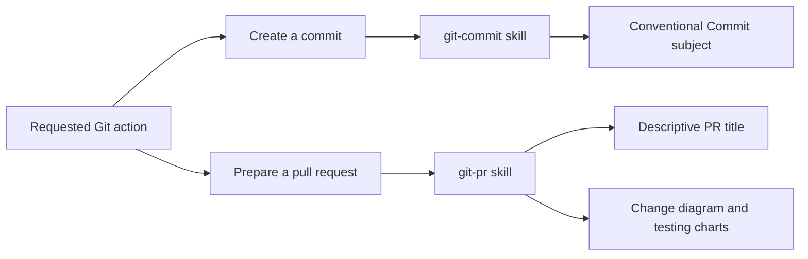
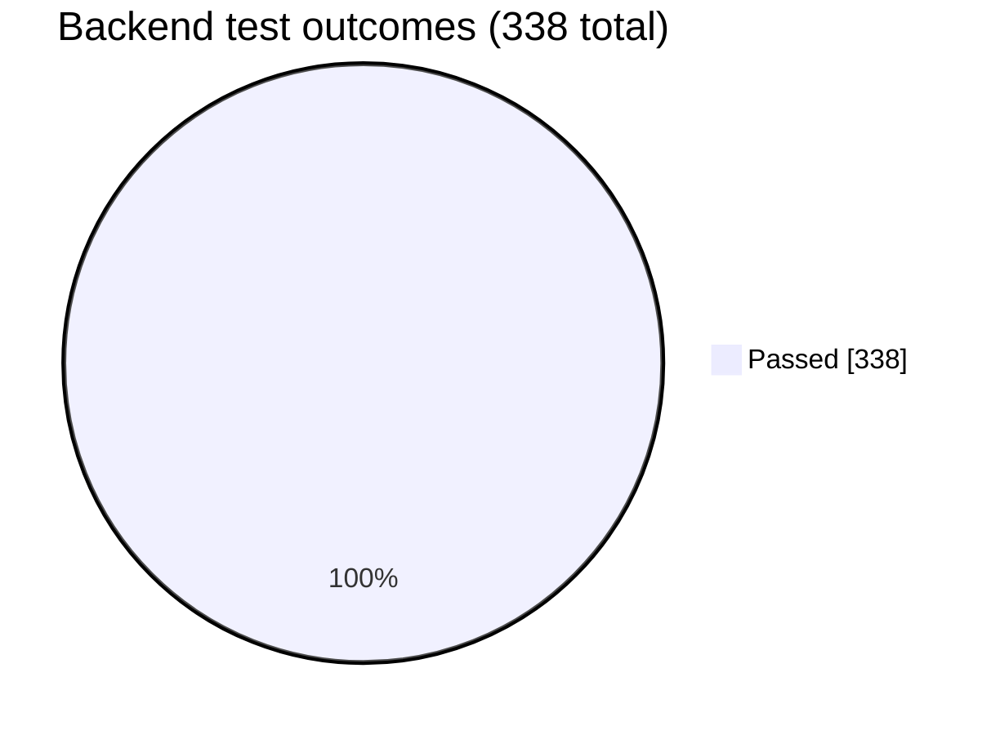
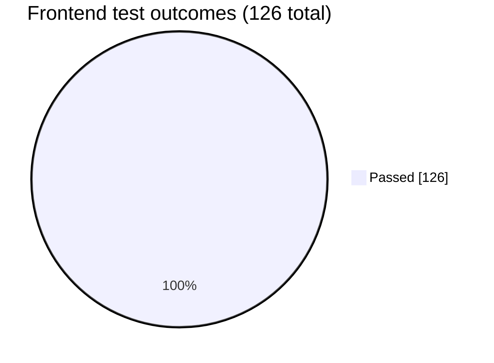
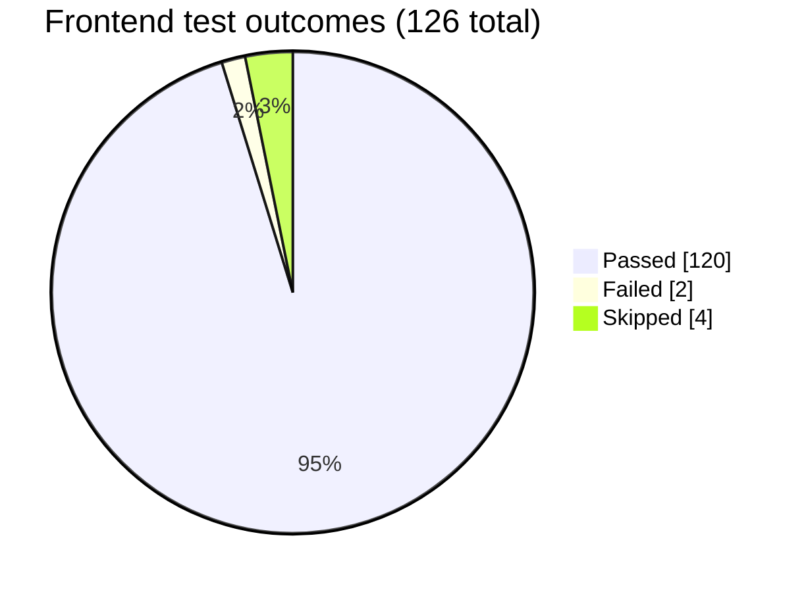
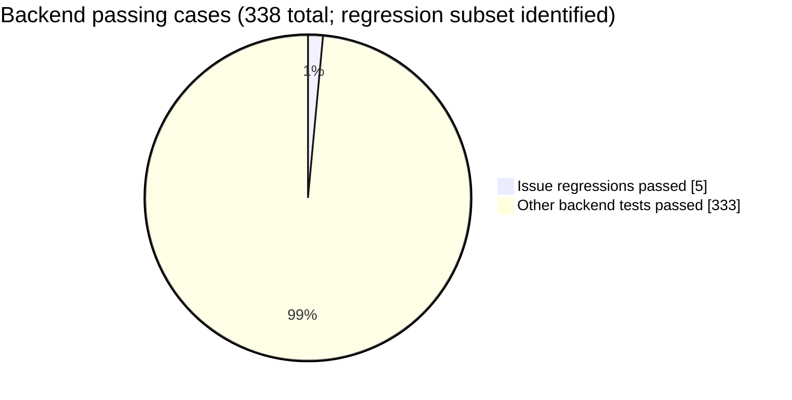
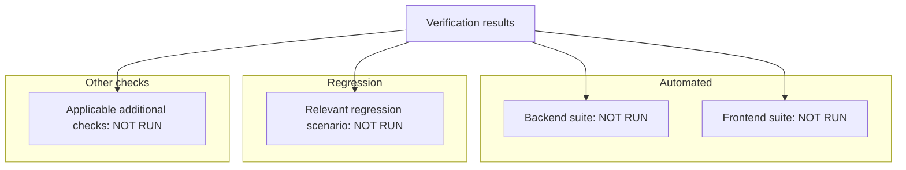

# PR chart examples

These few-shot examples demonstrate the preferred PR chart style. All numbers below are illustrative, not evidence for a new PR. Replace them with captured runner results and keep the adjacent evidence table. A pie describes reported test-case outcomes, not code coverage.

## Change overview

This documentation example shows which skill governs each requested action:

For runtime changes, show the changed runtime behavior instead. Use a sequence diagram for interactions or a flowchart for decisions and state changes.

## Shot 1: all reported tests pass

Input evidence: backend reports 338 passed; frontend reports 126 passed. Five backend regression tests are included in the 338. Build passed; browser checks were not run.

Preferred output — **Automated**:

**Regression:** the five named regression tests passed and are already included in the backend total. **Other checks:** build PASS; browser checks NOT RUN. Name the regressions and give commands and CI/log links in the evidence table. An all-passing pie is appropriate only when all reported tests passed; it says nothing about unexecuted checks.

## Shot 2: failures and skips remain visible

Input evidence: frontend reports 120 passed, 2 failed and 4 skipped (126 total). A browser run is blocked by an unavailable test service.

Preferred output — **Automated**:

**Regression:** identify which failing/skipped cases exercise the reported bug. **Other checks:** browser run BLOCKED — test service unavailable. The suite is FAIL; do not label the PR fully verified or chart only its passing cases. Blocked execution has no invented test count or pie slice.

## Shot 3: show a regression subset without double counting

Input evidence: 338 backend tests passed, including five issue-specific regression tests; 126 frontend tests passed separately.

Preferred output — **Automated / Regression**, backend breakdown:

This is an alternative to the backend outcome pie in Shot 1. Both slices belong to the same backend run and sum to 338. Keep the frontend's 126 cases in its own pie. Do not use slices of 338 backend, 126 frontend and 5 regression cases together: that would count the five regressions twice. **Other checks** still need explicit statuses in the table or a status chart.

## Fallback: counts unavailable or checks not run

Use labeled groups and explicit statuses when there are no meaningful measured counts for a pie. Replace each `NOT RUN` label only after obtaining evidence. This status chart can also accompany measured pies to show remaining checks.

Replace the generic scenario and additional-check nodes with named checks relevant to the PR. If a category does not apply, retain the group with an `N/A` node and explain why in the evidence table. Where a regression is included in an automated suite, label it as a subset rather than adding its count to a total.

Place an evidence table beside the chart with commands or reproduction steps, observed summaries, and available log or CI links. Keep failures, skipped checks, blockers, and unrun checks visible in both.
