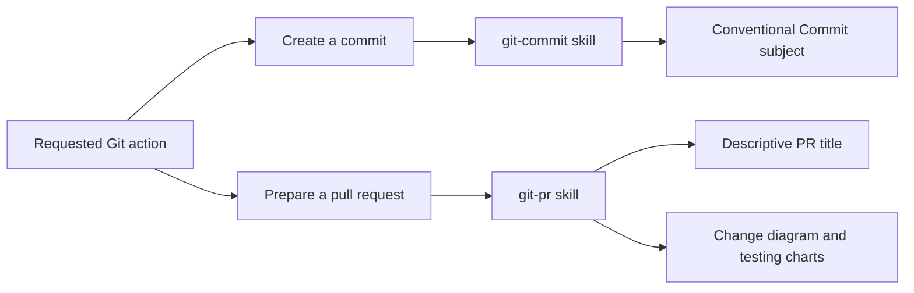
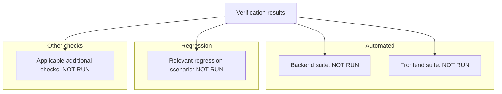

# PR chart examples

These examples demonstrate structure only. Adapt the change diagram to the actual diff and replace testing labels with observed results. The testing example intentionally claims no successful checks.

## Change overview

This documentation example shows which skill governs each requested action:

For runtime changes, show the changed runtime behavior instead. Use a sequence diagram for interactions or a flowchart for decisions and state changes.

## Testing results

Use labeled groups and explicit statuses. Replace each `NOT RUN` label only after obtaining evidence, and add counts only when reported by the runner.

Replace the generic scenario and additional-check nodes with named checks relevant to the PR. If a category does not apply, retain the group with an `N/A` node and explain why in the evidence table. Where a regression is included in an automated suite, label it as a subset rather than adding its count to a total.

Place an evidence table beside the chart with commands or reproduction steps, observed summaries, and available log or CI links. Keep failures, skipped checks, blockers, and unrun checks visible in both.