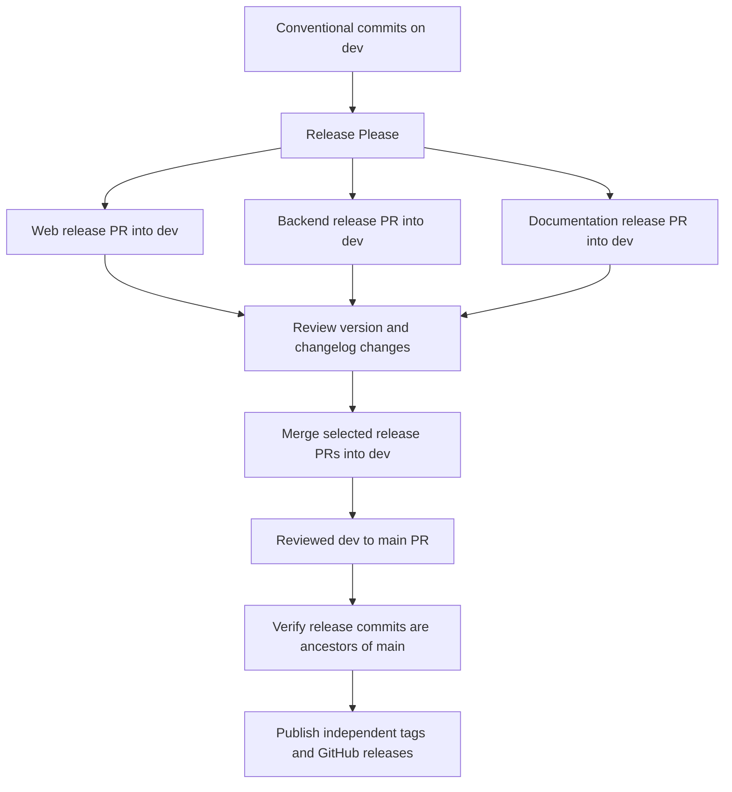

# Component releases

Release Please tracks web, backend, and documentation independently. Each component
has its own version, changelog, release PR, Git tag, and GitHub release.

| Component | Changes under | Version file | Changelog | Tag format |
| --- | --- | --- | --- | --- |
| Web | `frontend/` | `frontend/package.json` and `package-lock.json` | [Web changelog](../frontend/CHANGELOG.md) | `web-v0.1.0` |
| Backend | `backend/` | `backend/version.txt` | [Backend changelog](../backend/CHANGELOG.md) | `backend-v0.1.0` |
| Documentation | `docs/` | `docs/version.txt` | [Documentation changelog](CHANGELOG.md) | `docs-v0.1.0` |

The tag versions above are examples. All components start at `0.0.0`; Release Please
chooses the next version from their commits. Web releases update the npm lockfile
automatically. Backend uses the `simple` strategy because it is a Django service
without Python package version metadata. No npm or Python package is published.

## One-time GitHub setup

1. Enable GitHub Actions and allow it to create pull requests in repository
   **Settings → Actions → General → Workflow permissions**.
2. Add an Actions secret named `RELEASE_PLEASE_TOKEN` using a fine-grained PAT
   with access to this repository and **Contents**, **Issues**, and **Pull requests**
   read/write permissions. This lets bot-created PRs trigger normal validation.
   The workflow falls back to `GITHUB_TOKEN`, but GitHub suppresses workflows
   triggered by that token; CI on those PRs must then be triggered manually.
3. Merge this configuration into `dev` and promote it to `main` through the
   usual reviewed PR. The workflows become available on their respective branches.

The workflow's `issues: write` permission is used for release lifecycle labels.
It does not grant automatic approval or merging. Required CI checks and both local
application suites must pass before a merge.

## Release flow



1. Merge Conventional Commits into `dev`. Release Please runs on every push and
   opens or updates a separate PR for each changed component.
2. Review and merge the release PRs you want to publish. These PRs contain version
   bumps, component changelogs, and updates to `.release-please-manifest.json`.
3. Promote `dev` to `main` using a **merge commit**, preserving the release commits.
   Do not squash or rebase this promotion: the publisher verifies commit ancestry.
   The existing rule allowing only `dev` PRs into `main` remains in force.
4. The `main` workflow finds merged Release Please PRs still labelled
   `autorelease: pending`. It publishes only those whose merge commits are reachable
   from the workflow's production commit. Newer work on `dev` remains unpublished.
5. For each changed manifest version, the publisher creates a component tag at
   that release commit and a GitHub release with that version's changelog entry.
   Successful PRs become `autorelease: tagged`. Independent releases do not compete
   for the repository's single GitHub “latest release” designation.

Release Please pauses creation of further release PRs while merged release PRs
remain pending. Promote those PRs and publish them before preparing the next cycle.
Components need not share version numbers, and a documentation-only release does
not increment either application version. Promotion still deploys everything
included in `dev`; this automation separates release metadata, not deployment jobs.

## Commit conventions and changelogs

Release Please assigns commits by changed paths, not commit scopes. A commit that
changes both application directories can appear in both component changelogs.
Use the existing Conventional Commit conventions: features increment minor,
fixes increment patch, and breaking changes increment major (minor while below
`1.0.0`). Documentation, build/dependency, refactor, test, CI, and maintenance
commits are visible in changelogs and can produce patch releases.

Keep documentation in `docs/` to include it in documentation releases. Changes only
to root files, `.github/`, or agent tooling do not trigger a component release.
Preserve Conventional Commit messages when merging feature work. The human-readable
Release Please PR title is generated metadata; its merged commit is excluded from
future component notes by the release boundary.

`bootstrap-sha` in `release-please-config.json` marks the existing commit immediately
before this automation was introduced. Initial changelogs start after that point;
historical releases, including the `2526-sem2` tag, are retained. Later cycles use
the published component tags as their release boundaries. Do not move the bootstrap
SHA forward during normal maintenance.

## Verification and recovery

Run from the repository root:

```sh
node --test .github/scripts/publish-releases.test.cjs
```

The Release Automation Tests workflow runs the same tests for relevant PR changes.
The tests cover component isolation, commit ancestry, changelog extraction, partial
failures, retries, and rejection of unrelated PRs. Before merging, also run
`python manage.py test` from an activated backend virtual environment and
`npm run test -- --run` from `frontend/`, and inspect required CI results.

To recover a failed publication, rerun the failed workflow or manually run
**Release Please** with branch `main` selected. Existing releases are skipped;
the pending label stays until every component in that PR has published. Never
remove that label manually to bypass an error. A manual run on `dev` refreshes
release PRs; it does not publish production releases. No workflow auto-merges PRs
or changes deployment settings.

Upstream references: [Release Please Action](https://github.com/googleapis/release-please-action)
and [manifest configuration](https://github.com/googleapis/release-please/blob/main/docs/manifest-releaser.md).
