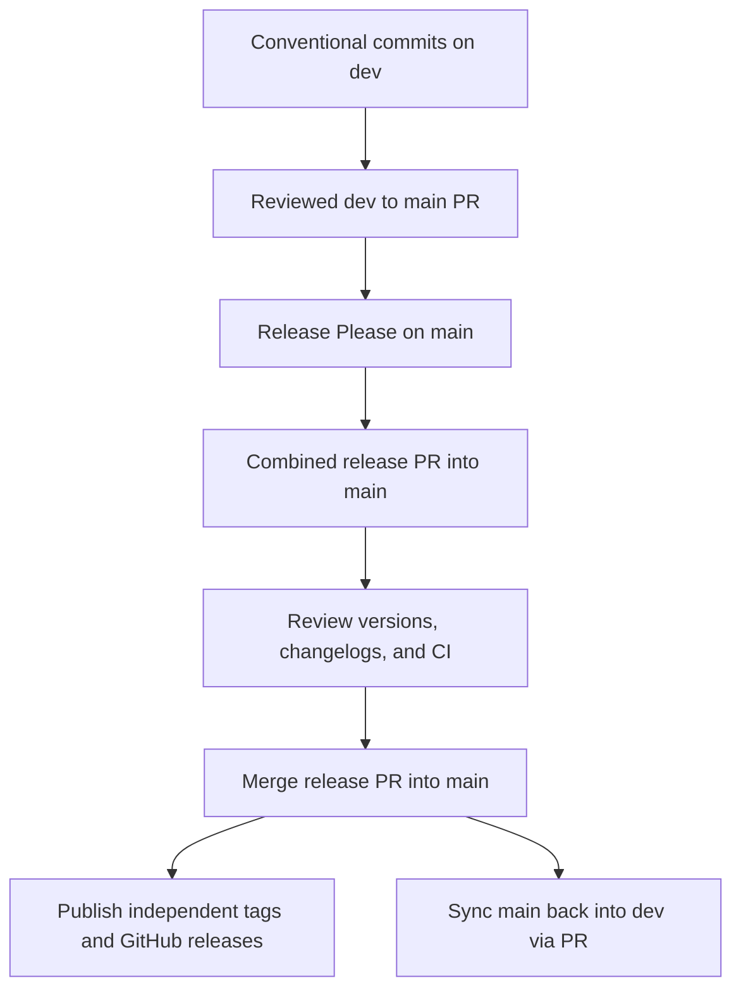

# Component releases

Release Please tracks web, backend, and documentation independently. Each component
has its own version, changelog, Git tag, and GitHub release. All changed components
share one release PR so updates to `.release-please-manifest.json` land together.

| Component | Changes under | Version file | Changelog | Tag format |
| --- | --- | --- | --- | --- |
| Web | `frontend/` | `frontend/package.json` and `package-lock.json` | [Web changelog](../frontend/CHANGELOG.md) | `web-v0.1.0` |
| Backend | `backend/` | `backend/version.txt` | [Backend changelog](../backend/CHANGELOG.md) | `backend-v0.1.0` |
| Documentation | `docs/` | `docs/version.txt` | [Documentation changelog](CHANGELOG.md) | `docs-v0.1.0` |

The tag versions above are examples. All components start at `0.0.0`; Release Please
chooses the next version from their commits. Web releases update the npm lockfile
automatically. Backend uses the `simple` strategy because it is a Django service
without Python package version metadata. No npm or Python package is published.

## One-time GitHub setup

1. Enable GitHub Actions and allow it to create pull requests in repository
   **Settings → Actions → General → Workflow permissions**.
2. Add an Actions secret named `RELEASE_PLEASE_TOKEN` using a fine-grained PAT
   with access to this repository and **Contents**, **Issues**, **Pull requests**, and **Workflows**
   read/write permissions. This lets bot-created PRs trigger normal validation.
   The workflow falls back to `GITHUB_TOKEN`, but GitHub suppresses workflows
   triggered by that token; CI on those PRs must then be triggered manually.
3. Merge this configuration into `dev` and promote it to `main` through the
   usual reviewed PR. The workflows become available on their respective branches.

The workflow's `issues: write` permission is used for release lifecycle labels.
Production publication uses the configured release token (falling back to `GITHUB_TOKEN`)
to create releases, tag commits, and update labels on release PRs.
These permissions do not grant automatic approval or merging. Required CI checks and both local
application suites must pass before a merge.

## Release flow



1. Merge Conventional Commits into `dev`, then promote application work to `main`
   through a reviewed PR. Release Please reads the commits already on `main`.
2. On each push to `main`, publish pending releases first, then prepare or update
   one combined release PR targeting `main`. Components without releasable changes
   retain their versions. Publication failures stop preparation until recovery.
3. Review the independent version bumps, changelogs, shared manifest, and CI.
   The branch check permits the same-repository `release-please--branches--main`
   branch as well as ordinary `dev` promotion PRs. Validation runs for both targets.
4. Merge the release PR into `main`. The next workflow publishes component tags
   at its merge commit with the corresponding changelog entries, then marks the
   PR `autorelease: tagged`. Releases do not compete for the GitHub latest label.
5. Merge the existing main-to-dev sync PR to bring release metadata back to `dev`.

Release Please pauses new release PR creation while merged releases remain pending.
Rerun publication to finish those releases before starting the next cycle.
Components have independent version numbers; a docs-only release does not bump
application versions. No workflow auto-merges release PRs.

## Commit conventions and changelogs

Release Please assigns commits by changed paths, not commit scopes. A commit that
changes both application directories can appear in both component changelogs.
Use the existing Conventional Commit conventions: features increment minor,
fixes increment patch, and breaking changes increment major (minor while below
`1.0.0`). Documentation, build/dependency, refactor, test, CI, and maintenance
commits are visible in changelogs and can produce patch releases.

Keep documentation in `docs/` to include it in documentation releases. Changes only
to root files, `.github/`, or agent tooling do not trigger a component release.
Preserve Conventional Commit messages when merging feature work. The human-readable
Release Please PR title is generated metadata; its merged commit is excluded from
future component notes by the release boundary.

`bootstrap-sha` in `release-please-config.json` marks the existing commit immediately
before this automation was introduced. Initial changelogs start after that point;
historical releases, including the `2526-sem2` tag, are retained. Later cycles use
the published component tags as their release boundaries. Do not move the bootstrap
SHA forward during normal maintenance.

## Verification and recovery

### Migrating release PRs from dev to main

Promote this configuration to `main` through the usual reviewed `dev` PR. Close
unmerged Release Please PRs targeting `dev`, then run **Release Please** on `main`
to create the replacement branch `release-please--branches--main`. Review the
replacement diff rather than copying an old manifest.

Already merged combined and legacy component release PRs targeting `dev` remain
eligible for publication once their merge commits are ancestors of `main`. Preserve
those commits with a merge promotion. Keep pending labels until publication succeeds.
New release PRs target `main` directly and need no additional promotion.

### Checks and publication recovery

Run from the repository root:

```sh
node --test .github/scripts/publish-releases.test.cjs
```

The Release Automation Tests workflow runs the same tests for relevant PR changes.
The tests cover component isolation, commit ancestry, changelog extraction, partial
failures, retries, and rejection of unrelated PRs. Before merging, also run
`python manage.py test` from an activated backend virtual environment and
`npm run test -- --run` from `frontend/`, and inspect required CI results.

To recover a failed publication, rerun the failed workflow or manually run
**Release Please** with branch `main` selected. Existing releases are skipped;
the pending label stays until every component in that PR has published. Never
remove that label manually to bypass an error. Manual dispatch must select `main`; a run on `dev` skips both jobs. No workflow auto-merges PRs
or changes deployment settings.

If a release was published but updating its PR labels returned HTTP 403, correct
the publication job's token permissions, promote that workflow fix to `main`,
then run **Release Please** on `main` again. A rerun of the old failed run still
uses the old workflow revision. The publisher skips the existing release and
retries the label updates; do not delete or recreate the release or its tag.

Upstream references: [Release Please Action](https://github.com/googleapis/release-please-action)
and [manifest configuration](https://github.com/googleapis/release-please/blob/main/docs/manifest-releaser.md).
