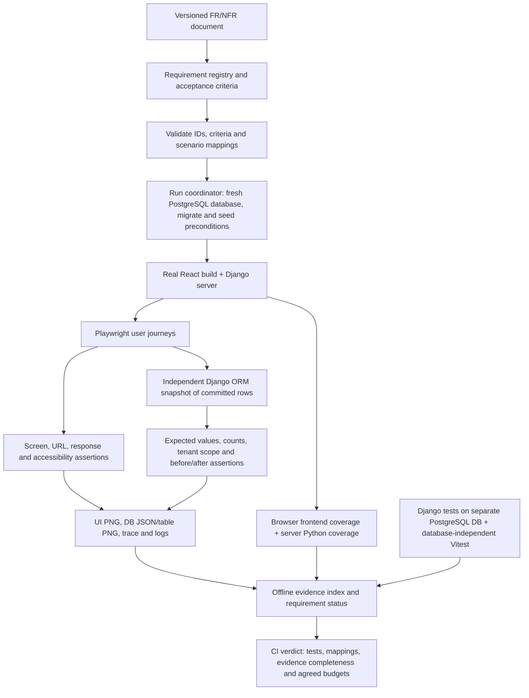

# Playwright E2E Testing, Requirements Traceability, and Evidence Pipeline

**Author:** Rafael 
**Created:** 29 October 2026, Asia/Manila 
**Status:** Proposed implementation plan; this document does not implement the pipeline. 
**Database decision:** PostgreSQL for all database-backed tests and Playwright runs, following the user's 29 October 2026 clarification. 
**Repository baseline:** `dev`, commit `235e0c2af7dde5d46477a80402b8b22740e59b3f`.

### Delivery boundaries

| PR | Scope | Depends on |
|---|---|---|
| 1 | Concise RTM and requirement IDs | `dev` |
| 2 | This plan and supporting assessment | PR 1 |
| 3 | PostgreSQL/Docker, test configuration, dependencies, unit-test CI | PR 2 |
| 4 | Backend fixtures, snapshots, E2E server, support tests | PR 3 |
| 5 | Playwright scenarios, requirement/evidence reports, browser CI | PR 4 |

Testing only. Changes to business rules or product UI belong in separate PRs. Test selectors must use the existing UI. Keep application views, serializers, models, hooks, and page behavior outside this stack.

## 1. Goal / Executive Summary

Build a repeatable local and GitHub Actions pipeline that proves an IPES requirement through a real browser journey, verifies the committed database result independently, and produces an evidence package that a reviewer can inspect.

Use PostgreSQL for all database-backed testing. Provision disposable databases on a dedicated local PostgreSQL instance and disposable CI service containers; never share the development or production database with tests. Frontend Vitest component tests remain database-independent. The cost is provisioning a PostgreSQL service and somewhat slower database setup; the benefit is exercising production-relevant constraints, transaction behavior and row locks in the ordinary suite.

Refine the original idea into this chain:

**Requirement → acceptance criteria → deterministic preconditions → Playwright actions → screen assertions → database assertions → screenshots and trace → requirements and code-coverage reports.**

Screenshots illustrate what happened. Assertions decide whether the requirement passed. A database screenshot will be a rendered, labeled view of actual queried rows, accompanied by the underlying JSON and before/after comparison. This avoids depending on a manually operated database GUI.

### 1.1 Starting point in this repository

| Observed baseline | Consequence for the design |
|---|---|
| [Requirements and reliability assessment](<D:/_src/PyCharm Projects/IPES/IPES/docs/generated/business_features_and_reliability_20261029.md>) already assigns stable IDs to 51 feature FRs, 37 feature NFRs, seven cross-cutting NFRs, and separately advertised reminder capabilities. | Reuse these IDs; retain the document's distinction between synthesized requirements and approved acceptance criteria. Its issue inventory is historical input, not a new verification of current GitHub status. |
| [backend/IPES/settings.py](<D:/_src/PyCharm Projects/IPES/IPES/backend/IPES/settings.py>) selects SQLite only when `test` occurs in command arguments. | Remove this override as part of implementation and route ordinary backend tests to isolated PostgreSQL test settings. The E2E server uses its own PostgreSQL database. |
| [frontend/package.json](<D:/_src/PyCharm Projects/IPES/IPES/frontend/package.json>) and installed packages use React 19, Vite 8.3.5 and Vitest 5.0.3. | Base implementation on actual configuration rather than older stack versions in the agent guide. |
| [frontend/vite.config.ts](<D:/_src/PyCharm Projects/IPES/IPES/frontend/vite.config.ts>) uses port 5173 and proxies to port 8000; [frontend/src/lib/api.ts](<D:/_src/PyCharm Projects/IPES/IPES/frontend/src/lib/api.ts>) defaults to relative `/api`. | Allocate E2E-only ports 5175/8001 and configure the preview proxy explicitly. |
| [.github/workflows/pr-validate.yml](<D:/_src/PyCharm Projects/IPES/IPES/.github/workflows/pr-validate.yml>) runs both suites, has advisory lint steps, and currently selects Node 20. | Add E2E jobs alongside existing validation; standardize Node to the locally verified 24.14.0 for this work. Making lint mandatory is a separate policy decision. |
| [backend/apps/evaluations/tests/test_concurrent_answers.py](<D:/_src/PyCharm Projects/IPES/IPES/backend/apps/evaluations/tests/test_concurrent_answers.py>) skips its row-lock test on SQLite. | Require it to execute on PostgreSQL in the ordinary backend PR job from the first implementation milestone. |

### 1.2 What coverage means

| Metric | Tool / source | What reviewers can conclude |
|---|---|---|
| Requirements coverage | Requirement registry + scenario results | Which acceptance criteria were mapped, executed and satisfied on this revision. |
| Django code coverage | coverage.py, with branch measurement | Which Python statements and branches ran under backend tests and, separately, browser-driven server requests. |
| Frontend unit/component coverage | Vitest + its matching V8 coverage provider | Which original TS/TSX code ran under existing frontend tests. |
| Frontend E2E execution coverage | Playwright Chromium coverage → source-map remapping → Istanbul reports | Which frontend code the browser journeys exercised. This is a distinct report with browser/tool limitations. |

JaCoCo measures Java. Use coverage.py for Python and V8/Istanbul tooling for JavaScript/TypeScript. Keep all four metrics visible; do not average backend and frontend percentages or equate executed code with correct behavior.

## 2. Critical Items

> [!IMPORTANT]
> **Dedicated test data only.** Provision fresh PostgreSQL databases on a dedicated local test instance or disposable CI service. Backend tests and E2E runs use different databases. Never connect tests to the developer's normal database or a shared Supabase instance. All provision, seed, snapshot and drop operations must validate the test instance, test-only role, exact database name and run ownership marker.

> [!IMPORTANT]
> **Preserve the actual application path.** Exercise real React pages, the existing API client, session login, masked CSRF bootstrapping, organization headers, Django permissions, ORM writes and membership signals. Do not mock business endpoints in the main workflow suite. Deliberate network-failure scenarios are separately labeled resilience tests.

> [!IMPORTANT]
> **Plan-only deliverable.** Acceptance thresholds and requirement wording below are proposals. Requirements that lack agreed criteria remain unresolved in the report. The existing requirements assessment reports defects; tests must express the intended contract, even when it currently fails.

> [!WARNING]
> **Local HTTP has a narrower security scope.** The isolated settings may disable Secure cookies solely for the loopback HTTP server. Keep HttpOnly and CSRF checks enabled. HTTPS cookie delivery, deployed origins, CSP and real storage require a separately configured deployment check and cannot be marked passed by local HTTP E2E.

> [!IMPORTANT]
> **Replace the SQLite testing policy.** The user's clarification selects PostgreSQL throughout. Implementation must remove the automatic SQLite switch and update the conflicting test-database guidance in the agent guide and testing documentation. Preserve test isolation and fail when PostgreSQL is unavailable; do not fall back silently to SQLite. This supersedes the earlier SQLite-specific guidance for this work.

## 3. Open Questions and Working Defaults

The following items do not block creating the harness or the first scenarios. Resolve them before promoting affected checks into acceptance/release gates.

| Question | Working default |
|---|---|
| Is there a separate approved requirements document? | Start from the local requirements assessment and manifesto; preserve IDs and record source revision. Reconcile a later approved document explicitly. |
| Which browsers and devices are officially supported? | Chromium desktop is the first PR gate; add Firefox, WebKit and a 390×844 mobile viewport in the expanded run. Proposed coverage is not a support promise. |
| What latency, capacity, availability and recovery targets are accepted? | Publish measurements without a pass claim until workload, environment and thresholds are approved. |
| Which existing defects block rollout? | Report expected behavior honestly. A temporary exception requires a linked issue, owner, scope and expiry; it never counts as satisfied. |
| How long should evidence remain available? | Propose 14-day CI artifact retention for synthetic-data runs. Keep representative acceptance evidence longer only when explicitly required. |
| Are reminder requirements part of the current delivery? | Keep the advertised reminder items visible as unimplemented/unverified until their product contract is confirmed. No email delivery is part of this pipeline plan. |
| Which PostgreSQL major version, extensions and collation does production use? | Match the production major version in local and CI tests before implementing. PostgreSQL 17 is only a provisional baseline until deployment metadata is checked; do not claim exact Supabase parity. Install extensions only when the app actually requires them. |

## 4. Proposed Changes

### 4.1 Pipeline architecture

The run coordinator owns setup, readiness checks, subprocess shutdown, finalization and cleanup. Reporting runs even after a test failure, while preserving a failing exit code.

### 4.2 Requirements as an executable contract

#### [NEW] [docs/testing/requirements_traceability_matrix.md](<D:/_src/PyCharm Projects/IPES/IPES/docs/testing/requirements_traceability_matrix.md>)

Keep one concise table row per requirement: ID, short requirement, planned verification, and browser mapping scope. Scenario IDs link to a compact scenario catalog. Mapping and execution results are separate; non-browser checks and unconfirmed reminder scope stay visible.

#### [NEW] [docs/testing/requirements.json](<D:/_src/PyCharm Projects/IPES/IPES/docs/testing/requirements.json>)

Generate the machine-readable companion from the RTM table, preserving its IDs and scenario mapping. Each entry contains:

- Stable `id`, requirement type, feature, source file/section, source revision/hash, risk and lifecycle status.
- Independently identifiable acceptance criteria, actor/role, organization scope, preconditions and expected outcome.
- Scenario IDs, test layer (`browser`, `api`, `database`, `load`, `manual`, `operational`), required environment and evidence obligations.
- Related issue URLs and explicit exception metadata where applicable.
- For measurable NFRs: workload, sample count, environment and target. An unset target remains unresolved rather than passing.

Use JSON to avoid adding a parser dependency. Validate its shape with the repository's existing Zod dependency in tooling; do not parse free-form prose at test runtime or automatically treat AI-generated tests as approved criteria.

#### [NEW] [frontend/scripts/validate-requirements.mjs](<D:/_src/PyCharm Projects/IPES/IPES/frontend/scripts/validate-requirements.mjs>)

Validate schema, unique IDs, source references, acceptance-criterion mappings and unknown/removed IDs. Compare mappings with Playwright's discovered tests, including tags/annotations, rather than searching test source strings alone. Every gating scenario must actually be discoverable. Backend/manual checks have explicit evidence adapters and cannot masquerade as browser tests.

#### [NEW] [frontend/e2e/reporters/requirements-reporter.ts](<D:/_src/PyCharm Projects/IPES/IPES/frontend/e2e/reporters/requirements-reporter.ts>)

Combine the registry and actual run results into JSON and HTML. Record scenario ID, criterion IDs, project/browser, attempt, duration, error, artifact links and run identity.

Show separate counts for **mapped**, **executed**, and **satisfied**, with satisfied requiring all mandatory criteria and checks for that requirement to pass. Distinguish failed, flaky, skipped, blocked, unimplemented, manual/unverified and out-of-scope entries. Denominators include all applicable approved requirements; skips and exceptions never become passes. Show whole-document coverage alongside selected PR-gate coverage so a small smoke run cannot imply complete assurance.

### 4.3 Deterministic, isolated database and process lifecycle

#### [NEW] [compose.test.yml](<D:/_src/PyCharm Projects/IPES/IPES/compose.test.yml>)

Provide a dedicated PostgreSQL test service, bound to `127.0.0.1:55432` locally, with a `pg_isready` health check and disposable storage. Use Docker Desktop with Linux containers on Windows and Docker Engine on Linux. A separately installed local PostgreSQL test instance is acceptable when configured with the same version and isolation checks. Keep database files out of the application checkout and mount no development/production data directory. Pin the selected image digest during implementation after confirming the production major version.

#### [MODIFY] [backend/IPES/settings.py](<D:/_src/PyCharm Projects/IPES/IPES/backend/IPES/settings.py>)

Remove the `if 'test' in sys.argv` SQLite override. Retain the production PostgreSQL configuration and avoid loading test-only credentials into normal application settings.

#### [MODIFY] [backend/manage.py](<D:/_src/PyCharm Projects/IPES/IPES/backend/manage.py>)

Route `python manage.py test` to the dedicated test settings before Django initialization. Reject overrides that would run database-backed tests with the normal development/production settings. Require test-only configuration; never infer the test target from the root application's `.env` credentials.

#### [NEW] [backend/IPES/settings_test.py](<D:/_src/PyCharm Projects/IPES/IPES/backend/IPES/settings_test.py>)

Use PostgreSQL from test-only environment variables and validate an explicitly provisioned test-instance marker. Configure `DATABASES['default']['TEST']['NAME']` to a run-specific name such as `test_ipes_unit_<run-id>`. Let Django's test runner create/migrate/drop that database. Use `TestCase` rollback isolation normally and `TransactionTestCase` for actual commit/concurrency tests. The test role needs `CREATEDB` and access to the maintenance `postgres` database, but no superuser or role-management privileges. Any bootstrap superuser credential stays confined to the disposable cluster's provisioning step.

#### [NEW] [backend/scripts/test_database.py](<D:/_src/PyCharm Projects/IPES/IPES/backend/scripts/test_database.py>)

Centralize test-instance validation, E2E database provisioning and exact-target cleanup. Support a local loopback endpoint or the explicitly named CI service; refuse arbitrary remote targets. Provision `ipes_e2e_<run-id>` separately from Django's unit-test database, record its ownership marker, and migrate through the normal Django command. Use properly quoted PostgreSQL identifiers, autocommit for database creation/deletion, names within PostgreSQL's identifier limit and a fresh connection to validate the actual engine/server version. Do not implement broad prefix-based database deletion. Stale runs require an exact recorded run identity.

#### [NEW] [backend/IPES/settings_e2e.py](<D:/_src/PyCharm Projects/IPES/IPES/backend/IPES/settings_e2e.py>)

Derive shared test configuration from the PostgreSQL test settings, with the support app enabled only for E2E. Require `IPES_E2E=1` and a coordinator-created run marker; point the server directly to its newly provisioned `ipes_e2e_<run-id>` database. A running Playwright server does not use Django's test-runner database lifecycle, so the coordinator must create and migrate this database explicitly. Use test-only credentials, local media/avatar storage, a local-memory email backend and run-scoped cache names. Bind HTTP servers to loopback with explicit allowed hosts/origins.

Keep session authentication, HttpOnly cookies and CSRF middleware intact. Set `SESSION_COOKIE_SECURE=False`, `CSRF_COOKIE_SECURE=False` and `SameSite=Lax` only in these loopback settings. Supply throwaway configuration values in CI so importing base settings does not require real secrets.

#### [NEW] [backend/apps/e2e_support/apps.py](<D:/_src/PyCharm Projects/IPES/IPES/backend/apps/e2e_support/apps.py>)
#### [NEW] [backend/apps/e2e_support/management/commands/seed_e2e.py](<D:/_src/PyCharm Projects/IPES/IPES/backend/apps/e2e_support/management/commands/seed_e2e.py>)
#### [NEW] [backend/apps/e2e_support/management/commands/snapshot_e2e.py](<D:/_src/PyCharm Projects/IPES/IPES/backend/apps/e2e_support/management/commands/snapshot_e2e.py>)
#### [NEW] [backend/apps/e2e_support/management/commands/run_e2e_server.py](<D:/_src/PyCharm Projects/IPES/IPES/backend/apps/e2e_support/management/commands/run_e2e_server.py>)
#### [NEW] [backend/apps/e2e_support/tests/test_commands.py](<D:/_src/PyCharm Projects/IPES/IPES/backend/apps/e2e_support/tests/test_commands.py>)

Load this support app only from E2E settings; it has no HTTP routes.

- `seed_e2e`: create a versioned scenario fixture and return a JSON manifest with actual IDs. Seed two organizations, separate admin/member users, an outsider, revoked access, unit/position structure and scenario-specific preconditions. Use ORM saves/create_user so Membership signals and password hashing run normally; never bypass signals with bulk membership writes.
- Namespace every scenario by run ID, scenario ID, browser/project and retry. A fresh browser context and fixture namespace are created for each attempt. Begin with one worker and serial database mutations; browser isolation alone does not isolate database state.
- Seed only preconditions. If a scenario tests form creation, submission, approval or generation, the tested output must be created by browser actions, never preinserted by the fixture.
- `snapshot_e2e`: accept an allowlisted snapshot type plus fixture manifest; query via the ORM in a separate process/connection after the request completes. Return selected committed rows, exact counts and namespace/organization identifiers. It performs no writes and accepts no arbitrary SQL or model/field names.
- `run_e2e_server`: host the normal Django WSGI application on 127.0.0.1:8001, with threading suitable for the app. Own coverage start/stop/save in `try/finally`; use a loopback parent-control channel for graceful shutdown. This avoids Windows terminate behavior silently losing coverage. It is a testing server, not a production deployment.
- Test refusal under normal settings, invalid instance/run markers, wrong database names or roles, path escape, foreign namespaces, repeated fixture setup, snapshot projection and cleanup boundaries. Include tests proving seeded final outcomes cannot satisfy the first workflow by themselves.

#### [NEW] [frontend/scripts/run-e2e.mjs](<D:/_src/PyCharm Projects/IPES/IPES/frontend/scripts/run-e2e.mjs>)

Provide a Windows/Linux coordinator using argument arrays with `spawn`, the backend's activated/selected Python executable and no shell-built command strings. Its lifecycle is:

1. Verify runtime/dependencies and PostgreSQL health/version, refuse occupied E2E HTTP ports, and create a marked runtime directory beneath [backend E2E runtime directory](<D:/_src/PyCharm Projects/IPES/IPES/backend/.e2e>). Record the validated test-instance identity.
2. Provision a fresh PostgreSQL database, select E2E settings, migrate it and seed baseline prerequisites. Assert the active Django connection vendor is `postgresql`; report its actual server version.
3. Build React in E2E mode, start the Django server and Vite preview, and poll real HTTP readiness with a bounded timeout. Keep `VITE_API_BASE_URL=/api` explicit so local frontend environment files cannot redirect requests.
4. Run Playwright and collect the browser result.
5. In `finally`, request clean server shutdown, wait for the coverage file, finalize reports and preserve the original failure status. Missing coverage/evidence is a visible infrastructure failure when required.
6. Stop browser/server/helper processes and close their DB connections; archive allowed evidence; drop only the exact PostgreSQL database owned by this run. Remove only its validated media/runtime directory. Stop a test container only if this invocation created and owns it; never stop a developer-managed test service or flush a development database.

Use one run directory and PostgreSQL database per coordinator invocation; never share Django's unit-test database with the browser server. Do not reset a shared database between concurrent tests. Parallelization is a later optimization requiring one stack/database per worker or shard. Use committed fixtures for browser runs: records inside Django `TestCase` transactions are not valid preconditions for an external server connection.

### 4.4 Playwright configuration and browser fixtures

#### [NEW] [frontend/playwright.config.ts](<D:/_src/PyCharm Projects/IPES/IPES/frontend/playwright.config.ts>)
#### [NEW] [frontend/e2e/fixtures/test.ts](<D:/_src/PyCharm Projects/IPES/IPES/frontend/e2e/fixtures/test.ts>)
#### [NEW] [frontend/e2e/helpers/database.ts](<D:/_src/PyCharm Projects/IPES/IPES/frontend/e2e/helpers/database.ts>)

Start with `testDir: ./e2e`, `fullyParallel: false`, one worker, 30-second test timeouts, five-second assertion timeouts, `forbidOnly` in CI and zero automatic retries in the gating run. A separate diagnostic rerun may capture a retry; its success must not erase the original failure.

The coordinator owns servers; Playwright uses the exact prestarted base URL `http://127.0.0.1:5175`. Provide named `chromium`, `firefox`, `webkit` and `mobile-chromium` projects; select only Chromium for the first gate.

Use accessible roles/names and web-first assertions. Add a minimal stable `data-testid` only where semantics do not identify an element. Wait for the specific mutation response and visible outcome, then poll a bounded committed-state snapshot where necessary. Avoid fixed sleeps and broad `networkidle` waits.

Each scenario signs in through the real UI initially. If reusable login storage is introduced later, generate it per role/scenario, never upload it, and keep dedicated login/logout/CSRF tests. Verify organization switching through the UI; do not globally force one organization header, which would hide client-scoping defects. Adversarial requests use the browser's cookie-aware request context and the real CSRF bootstrap where a mutation is intended.

#### [MODIFY] [frontend/vite.config.ts](<D:/_src/PyCharm Projects/IPES/IPES/frontend/vite.config.ts>)
#### [MODIFY] [frontend/vitest.config.ts](<D:/_src/PyCharm Projects/IPES/IPES/frontend/vitest.config.ts>)
#### [MODIFY] [frontend/package.json](<D:/_src/PyCharm Projects/IPES/IPES/frontend/package.json>)
#### [MODIFY] [frontend/package-lock.json](<D:/_src/PyCharm Projects/IPES/IPES/frontend/package-lock.json>)

In E2E mode only, build to an isolated output directory with hidden source maps and an asset manifest; configure `preview.proxy` to send relative `/api` traffic to 127.0.0.1:8001. Preserve normal development ports and the existing CSP. Preview must use strict port selection.

Exclude E2E specs, generated reports and runtime files from Vitest discovery. Add these exact proposed scripts:

| Script | Behavior |
|---|---|
| `test:coverage` | `vitest run --coverage` |
| `test:e2e` | `node scripts/run-e2e.mjs --project=chromium` |
| `test:e2e:all` | Coordinator selects all browser projects. |
| `test:e2e:headed` | Coordinator forwards `--headed` to Chromium. |
| `test:e2e:report` | `playwright show-report playwright-report` |
| `test:requirements` | `node scripts/validate-requirements.mjs` |

### 4.5 Initial scenario inventory

Each scenario owns a fresh fixture namespace. Prefer focused journeys over one test that depends on every previous test having passed. Implement the first six journeys before broadening the inventory.

#### [NEW] [frontend/e2e/specs/auth-and-tenancy.spec.ts](<D:/_src/PyCharm Projects/IPES/IPES/frontend/e2e/specs/auth-and-tenancy.spec.ts>)
#### [NEW] [frontend/e2e/specs/evaluation-lifecycle.spec.ts](<D:/_src/PyCharm Projects/IPES/IPES/frontend/e2e/specs/evaluation-lifecycle.spec.ts>)
#### [NEW] [frontend/e2e/specs/portfolio-review.spec.ts](<D:/_src/PyCharm Projects/IPES/IPES/frontend/e2e/specs/portfolio-review.spec.ts>)
#### [NEW] [frontend/e2e/specs/administration-and-audit.spec.ts](<D:/_src/PyCharm Projects/IPES/IPES/frontend/e2e/specs/administration-and-audit.spec.ts>)

| Scenario | Requirement examples | Browser outcome | Independent DB outcome |
|---|---|---|---|
| S01: Sign in, select organization, sign out | F01-FR02, F02-FR02, F01-NFR02 | Correct role workspace, retained organization selection, logout prevents reuse. | Expected active user/role; a captured old session key no longer authenticates. Never attach raw session values. |
| S02: Create form/questions, activate, generate assignments | F05-FR01/02/04, F06-FR02 | Form and complete assignment matrix appear. | Correct form/question/rule rows; expected unique evaluator/evaluatee pairs; repeating generation creates no duplicates. |
| S03: Save draft, reload, submit evaluation | F07-FR02/03/04, F07-NFR01 | Draft survives reload; submission is complete and read-only. | One Response per assignment/question; correct values; `Completed`, `submitted_at` and independently calculated `total_score`. |
| S04: Release results | F08-FR01/02/03, F08-NFR01 | Intended member aggregate appears only after release; evaluator identity remains confidential. | `results_released=True`, `is_active=False`; answers/scores preserved; correct audit scope/action. Also check unreleased API routes for disclosure. |
| S05: Submit and review accomplishment | F10-FR01, F11-FR02/03, F11-NFR03 | Member sees Pending → Verified or Rejected, with the correct comment. | Correct owner/org/status/reviewer/comments; audit row belongs to the affected organization. |
| S06: Cross-organization denial and cache isolation | F02-NFR01, F09-NFR01, F12-FR02 | Switching tenants replaces displayed data; member/outsider cannot invoke admin actions. | Rejected operations leave organization B's rows unchanged and disclose no foreign results. |
| S07: Join approval, role revocation and rejoin | F03-FR02/03, F03-NFR01/02 | Correct membership and access immediately after decisions. | Membership, role, generated assignments and decision state are consistent; rejected input leaves no partial writes. |
| S08: Pagination and complete totals | F04-FR02, F06-FR04, F09-FR02, F11-FR01, F12-FR03 | Records beyond the first 20 are reachable and totals are complete. | More than 20 matching records exist; displayed count/export agrees with independent scoped count. |
| S09: Soft deletion and audit history | F02-FR04, F05-FR04, F12-NFR01 | Deactivated records leave active views; history remains available. | Entity retained with correct active/deleted flag; related historical data and prior AuditLog rows remain. |

For S03, use two 1–5 rating questions with weights 1 and 3 and answers 2 and 4: the expected stored weighted average is `(2×1 + 4×3)/4 = 3.5`. Calculate this expected value in the test, without calling the production score helper. Match the UI's specified formatting and compare stored floats with a deliberate tolerance.

The assessment's reported issues, including #233, #234, #240, #256, #260, #270 and #274, guide regression priority. Reproduce before classifying current failures. Do not change expected output to accommodate a bug. Capture contradictory evidence such as HTTP success plus an absent database row.

### 4.6 Screenshots and database evidence

#### [NEW] [frontend/e2e/helpers/evidence.ts](<D:/_src/PyCharm Projects/IPES/IPES/frontend/e2e/helpers/evidence.ts>)
#### [NEW] [frontend/scripts/build-evidence-report.mjs](<D:/_src/PyCharm Projects/IPES/IPES/frontend/scripts/build-evidence-report.mjs>)

For each mutation checkpoint, attach:

| Artifact | Required contents |
|---|---|
| UI screenshot | Successful visible outcome or the failing state, labeled by requirement/scenario/checkpoint. |
| Before/after DB JSON | Allowlisted rows and counts, queried after committed writes; include namespace, schema version and capture timestamp. |
| DB comparison | Expected versus actual values, inserted/updated rows, unchanged foreign-tenant rows and assertion status. |
| DB table screenshot | An escaped, local HTML table rendered from the actual JSON, showing relevant rows/columns and the comparison. Capture through a separate unmeasured browser context. |
| Playwright diagnostics | Trace retained on failure, failure screenshot, video retained on failure, selected browser errors and backend logs. |
| Provenance | Commit SHA, dirty-worktree indicator, run ID, fixture version, browser/project, database engine and requirement-registry hash. |

Snapshots exclude credentials, password hashes, CSRF/session tokens and raw private media. Trace files may contain synthetic authentication traffic, so retain them only in access-controlled CI artifacts, never a public report.

The static evidence index links requirement → criterion → scenario attempt → UI screenshot → DB JSON/table screenshot → trace → coverage reports. It labels a rendered database snapshot accurately; it is not a screenshot of PostgreSQL administration software. Keep machine-readable data as the audit source and use table PNGs for presentations/review.

Build evidence on test failure and on fixture/server failures where possible. A missing screenshot or snapshot is reported explicitly; it must not be replaced with an empty successful artifact.

### 4.7 Coverage collection and reports

#### [NEW] [backend/requirements-dev.txt](<D:/_src/PyCharm Projects/IPES/IPES/backend/requirements-dev.txt>)
#### [NEW] [backend/.coveragerc](<D:/_src/PyCharm Projects/IPES/IPES/backend/.coveragerc>)
#### [NEW] [frontend/e2e/fixtures/browser-coverage.ts](<D:/_src/PyCharm Projects/IPES/IPES/frontend/e2e/fixtures/browser-coverage.ts>)
#### [NEW] [frontend/scripts/report-browser-coverage.mjs](<D:/_src/PyCharm Projects/IPES/IPES/frontend/scripts/report-browser-coverage.mjs>)

Use these initial version targets and lock installed npm dependencies exactly. Verify install/peer compatibility during the first implementation milestone; the table is a proposed reproducible baseline, not a claim these packages are already installed.

| Dependency/runtime | Proposed version | Purpose |
|---|---:|---|
| Python | 3.13.13 | Matches the local backend interpreter used for baseline tests. |
| Node | 24.14.0 | Matches the current local runtime; use consistently in CI. |
| `@playwright/test` | 1.64.1 | Browser runner and matching browser binaries. |
| `coverage` | 7.17.0 | Python statement/branch coverage and HTML/XML/JSON reports. |
| `@vitest/coverage-v8` | 5.0.3 | Match the installed Vitest version exactly. |
| `v8-to-istanbul` | 9.3.0 | Remap Chromium V8 execution data to Istanbul. |
| `istanbul-lib-coverage` | 3.2.2 | Merge compatible frontend coverage maps. |
| `istanbul-lib-report` | 3.0.1 | Coverage report context. |
| `istanbul-reports` | 3.2.0 | HTML, JSON summary and LCOV output. |
| `@axe-core/playwright` | 4.11.0 | Initial accessibility dependency target, verify against chosen Playwright before locking. |

**Backend:** configure `source=apps`, branch coverage, relative paths and explicit exclusions for migrations, tests and the E2E support app. Ordinary backend tests run under coverage with Django's PostgreSQL test-database lifecycle. E2E starts coverage in the actual server process against its separate PostgreSQL database and saves it after clean shutdown. Use separate raw data files and reports for backend tests and E2E. Do not run seeding/snapshot helpers under the server's coverage collector: their ORM activity must not inflate browser coverage. An optional same-revision combined backend report may be generated after retaining both original reports.

**Frontend unit/component:** configure explicit source include/exclude patterns so untested application files contribute to the denominator. Generate text summary, HTML, LCOV and JSON into a unit-only output directory.

**Frontend browser:** start JavaScript coverage before each application page loads, include newly opened pages, and stop/save it before page teardown. Capture every hard navigation boundary separately; the current Playwright documentation warns that disabling reset does not guarantee persistence. For these SPA scenarios, assert source mappings for lazy-loaded routes as well as shared modules. Filter out dependencies, generated helpers and the evidence renderer. Resolve original TS/TSX paths and hidden source maps from the exact E2E build. Fail report generation if mapped application files disappear, maps cannot be resolved, or a required coverage file is missing.

First implement a source-map proof using one known executed and one intentionally unexecuted source branch. Inventory application source files and represent unloaded files as uncovered; if complete coverage maps for unloaded files cannot yet be generated correctly, label the report **loaded application code only** and do not apply whole-application percentage gates. Do not silently present loaded-bundle coverage as total frontend coverage.

Native Playwright coverage is Chromium-only. Firefox/WebKit still run behavioral assertions and show frontend execution coverage as unavailable. Keep browser and unit frontend reports separate initially: merging incompatible V8 remappings can produce misleading branches. No custom Vite instrumentation plugin is required for the first implementation.

**Initial gates:** require nonempty, valid reports and establish measured baselines first. Introduce agreed per-layer floors and changed-code checks afterward; no arbitrary 80% global gate. Coverage cannot excuse missing high-risk acceptance scenarios.

### 4.8 Nonfunctional requirements need different test layers

#### [NEW] [frontend/e2e/specs/accessibility-and-resilience.spec.ts](<D:/_src/PyCharm Projects/IPES/IPES/frontend/e2e/specs/accessibility-and-resilience.spec.ts>)

| NFR family | Proposed verification | Limit |
|---|---|---|
| Tenant isolation, RBAC, confidentiality and CSRF | Browser flows plus cookie-aware adversarial API checks; verify denied writes and foreign-row invariants. | Browser UI visibility alone cannot establish authorization. |
| Accessibility, keyboard and responsive layouts | axe scans at key workflow states; Tab/Shift+Tab, modal focus return, accessible validation and 390×844 viewport checks. | Propose WCAG 2.1 AA checks as a starting target; manual screen-reader/usability review remains necessary. |
| Error recovery and consistency | Explicitly labeled request-failure/timeout tests verify understandable errors, no false success and preserved drafts; inspect DB after ambiguous mutation outcomes. | Request interception verifies failure handling, not real infrastructure resilience. |
| PostgreSQL transactions, schema and locking | Ordinary backend tests and every browser journey use PostgreSQL; include dedicated row-lock/rollback/length-constraint tests from the first milestone. Match the production major version. | The same engine does not establish parity with Supabase-managed configuration, extensions, network behavior or storage. |
| Performance and scalability | Record workflow/API timings and data volume; use existing query-budget tests. Define a dedicated load-tool milestone once workload/targets are agreed. | A browser timing assertion on shared CI is not load/capacity evidence. |
| Availability, backups and restore | Separate operational checklist and repeatable restore drill with defined RPO/RTO and media coverage. | Local E2E cannot establish uptime or disaster recovery. |
| Deployment security and object storage | Later controlled HTTPS environment with synthetic tenants; verify actual cookies/origins/CSP and storage integration. | Local filesystem avatar storage does not verify live Supabase storage. |

There is no separate optional PostgreSQL lane: it is the default engine for all database-backed checks. Require a validated local/CI test service, separate run-specific unit/E2E databases, a dedicated test-only role and ownership markers. Never accept normal production connection settings. Explicitly target [the row-lock test](<D:/_src/PyCharm Projects/IPES/IPES/backend/apps/evaluations/tests/test_concurrent_answers.py>) and add narrowly scoped rollback/constraint cases; confirm the concurrency test executes rather than skips in the ordinary PR job.

### 4.9 GitHub Actions and rollout

#### [MODIFY] [.github/workflows/pr-validate.yml](<D:/_src/PyCharm Projects/IPES/IPES/.github/workflows/pr-validate.yml>)
#### [NEW] [.github/workflows/e2e-expanded.yml](<D:/_src/PyCharm Projects/IPES/IPES/.github/workflows/e2e-expanded.yml>)
#### [MODIFY] [.gitignore](<D:/_src/PyCharm Projects/IPES/IPES/.gitignore>)
#### [MODIFY] [docs/TESTING.md](<D:/_src/PyCharm Projects/IPES/IPES/docs/TESTING.md>)
#### [MODIFY] [AGENTS.md](<D:/_src/PyCharm Projects/IPES/IPES/AGENTS.md>)

Update the testing documentation and agent guide to describe PostgreSQL test prerequisites, isolated database naming/lifecycle, the removed SQLite override and the distinction between current historical SQLite evidence and future PostgreSQL results. Preserve the existing backend/frontend suite commands after documented test-service/environment setup.

Add a Chromium E2E job for PRs to `dev`, in parallel with the existing suites, with a 15-minute job timeout and cancellation of superseded runs. Give both the backend-test job and browser-test job their own PostgreSQL service container, health check and test-only credentials. Assert the actual Django connection vendor/server version in both jobs; fail if PostgreSQL is missing. Use `npm ci`, the pinned runtime and `npx playwright install --with-deps chromium`. Install backend test dependencies, create only throwaway settings, and run the coordinator. Frontend unit tests need no database service.

Use a separate expanded workflow for manual dispatch and the proposed nightly multi-browser matrix; every database-backed matrix job also uses PostgreSQL. Each job owns its runtime/database. Scheduling is a future repository workflow change; no recurring task is created by this plan.

Upload evidence, reports and logs in an `always()` step, including failed runs, with a 14-day retention policy. Missing expected artifacts fail the report-integrity check. Use read-only repository permissions and no production secrets or `pull_request_target` execution of untrusted PR code. Unit/component coverage and E2E artifacts retain separate names.

Run requirement validation even when the full scenario inventory is incomplete. Initially fail only for malformed/unknown mappings and failures in explicitly designated gating scenarios; make gaps visible in every report. Promote scenarios into the required set as fixes land. A known failing critical requirement remains a release blocker even if a temporary pipeline exception allows development work.

Branch protection must be configured through repository settings after the new checks exist and have passed on the target revision. Workflow YAML alone does not make a check mandatory. Observe actual CI before changing required-check policy.

Ignore runtime DB/media, E2E builds/source maps, coverage raw data/HTML, Playwright output, storage-state files and generated evidence. Commit the registry, specs, scripts and curated visual baselines only.

### 4.10 Delivery sequence and exit criteria

| Milestone | Deliverable | Exit criterion |
|---|---|---|
| 1. Contract and isolation | PostgreSQL service and test settings, removal of the SQLite override, updated testing policy, registry/schema, coordinator, seed/snapshot commands; S01 and S03 vertical slice. | The complete backend suite passes on PostgreSQL with the row-lock test executed. Two successive E2E runs produce correct UI + committed DB assertions and both PNGs in separate PostgreSQL databases without touching the developer DB. Dependency/source-map spike passes. |
| 2. Core workflows and evidence | S02/S04/S05/S06, complete evidence reporter and requirements status. | Real browser writes are independently verified; a deliberately wrong DB expectation fails the run and remains inspectable. |
| 3. Coverage | Django unit/E2E reports, Vitest report, Chromium execution report with source-map validation. | Known executed/unexecuted code is represented correctly; clean shutdown saves server coverage on Windows and Linux; missing raw files fail visibly. |
| 4. CI gate | PostgreSQL services for backend and Chromium PR jobs, artifact upload and report-integrity validation. | A real CI pass and a deliberate failure both publish usable evidence; both jobs prove the active engine/version and the locking test runs. Required checks are configured only after inspection. |
| 5. Expanded assurance | S07–S09, accessibility/resilience and Firefox/WebKit/mobile, all database-backed checks on PostgreSQL. | Full registry distinguishes passed, failed and unverified requirements; unsupported NFR claims remain explicit. |

A successful first delivery is the complete vertical slice and CI gate, not every NFR being automatically provable. Later milestones expand the verified scope without inflating the reported requirement pass rate.

## 5. Verification Plan

### 5.1 Automated Tests

**Historical pre-implementation baseline executed for this plan, 29 October 2026:** These results used the repository's current SQLite override. They do not validate the proposed PostgreSQL configuration; PostgreSQL tests must be run after implementation.

| Command and directory | Observed result |
|---|---|
| Backend, activated existing virtual environment: `python manage.py test` | Latest rerun: 95 run in 31.066s: 94 passed, one skipped; exit 0. Row-lock test is skipped on SQLite. An unordered Organization pagination warning was emitted. |
| Frontend: `npm run test -- --run` | Latest rerun: 58 passed across 12 files in 10.92s; exit 0. |
| Playwright, coverage, PostgreSQL and new pipeline checks | Not run: proposed tooling/specs do not exist yet. |
| Actual GitHub CI / branch protection | Not inspected for this documentation task. |

**Commands after implementation, from the named directory:**

| Directory | Command | Expected verification |
|---|---|---|
| Repository root | `docker compose -f compose.test.yml up -d --wait` | Dedicated local PostgreSQL service is healthy; test-only role/environment setup follows the testing guide. |
| Backend with virtual environment activated and test-only environment loaded | `python manage.py test` | The complete regression suite passes on PostgreSQL; row-lock test executes. |
| Backend | `python -m coverage run --context=backend-tests manage.py test` | PostgreSQL tests run and Python statements/branches are collected using the new coverage configuration. |
| Backend | `python -m coverage html -d coverage/unit/html` and `python -m coverage xml -o coverage/unit/coverage.xml` | Readable unit-suite report and machine-readable artifact. |
| Frontend | `npm ci` | Lockfile reproducibly installs the selected versions. |
| Frontend | `npm run test -- --run` and `npm run test:coverage` | Unit/component regression and complete-source coverage. |
| Frontend | `npm run test:requirements` | Valid registry and discoverable criteria-to-test mappings. |
| Frontend | `npm run build` and `npm run lint` | Normal application build and lint; record existing failures separately. |
| Backend | `flake8 .` | Backend lint; record existing failures separately. |
| Frontend | `npx playwright install chromium`, then `npm run test:e2e` | First gated browser suite, independent DB assertions and complete artifacts. |
| Frontend | `npm run test:e2e:all` | Expanded browser/device behavioral matrix. |
| Backend with test-only PostgreSQL environment | `python manage.py test apps.evaluations.tests.test_concurrent_answers --settings=IPES.settings_test` | PostgreSQL locking case executes and passes, with no SQLite fallback. |

Additional harness checks must demonstrate:

1. Wrong settings, a developer DB target, an escaped runtime path or an occupied port abort before seeding.
2. S03 fails if the UI succeeds but the expected committed row/value is absent.
3. A denied cross-tenant mutation leaves targeted and unrelated rows unchanged.
4. Failed/skipped/flaky/manual checks are never counted as satisfied requirements.
5. Repeat runs and diagnostic retries use distinct fixture namespaces; no state carries over.
6. Hard navigation/lazy routes preserve correctly remapped coverage, or fail coverage validation.
7. Browser/assertion/server failures still produce reports; missing coverage is reported rather than converted to zero or a pass.
8. The support app/commands are unavailable in normal production settings and no test-only endpoint exists.
9. Backend/E2E jobs assert `connection.vendor == 'postgresql'` and record the actual server version. The row-lock test passes rather than skips; PostgreSQL unavailability causes a clear failure.
10. Database provisioning and cleanup refuse a mismatched instance marker, role, database owner/name or run ID. The unit-test database and E2E database are different, and evidence is captured before either is dropped.

### 5.2 Manual Verification

1. Run the E2E command from a clean shell following the updated testing guide; repeat on Windows and on the Linux CI runner.
2. Open the evidence index and follow one requirement through its criteria, browser outcome, UI PNG, before/after DB JSON, actual-row table PNG and trace.
3. Inspect S03's stored 3.5 score and compare it with the displayed formatting; verify the fixture did not seed the final response.
4. Temporarily change the expected DB score to a wrong value. Confirm a failing exit status, useful comparison and retained evidence.
5. Switch between two synthetic organizations and inspect both the screen and foreign-tenant DB invariants.
6. Open the four separate coverage reports. Check one covered/uncovered source branch, a lazy route and an unloaded file's denominator treatment.
7. Verify the developer database configuration/data remain untouched, only the exact run-owned PostgreSQL databases are dropped, and local media/runtime files are removed after shutdown. Confirm no broad database-prefix cleanup occurs.
8. Inspect a passing and failing GitHub Actions run, downloaded reports, artifact retention and the actual required-check configuration.
9. Record manual accessibility, performance-target approval and operational/deployment checks separately; leave those requirements unverified until their evidence exists.

### 5.3 Definition of Done

The implemented pipeline is complete when documented commands and PR jobs run every database-backed test on isolated PostgreSQL, exercise the first six journeys, assert committed DB state, publish UI/database screenshots and raw evidence, and show separate requirements/backend/frontend coverage reports. The complete backend suite must pass on PostgreSQL with the row-lock test executed, and frontend unit tests must still pass. No skipped requirement or unmeasured NFR is represented as satisfied, and database-safety and artifact-integrity failure cases have been demonstrated. Historical SQLite results alone cannot satisfy this definition.

## 6. Technical References

Documentation checked on 29 October 2026; verify the pinned packages during implementation.

- [Playwright server lifecycle guidance](https://playwright.dev/docs/test-webserver) and [configuration](https://playwright.dev/docs/test-configuration).
- [Playwright reports and attachments](https://playwright.dev/docs/test-reporters).
- [Playwright JavaScript coverage](https://playwright.dev/docs/api/class-coverage): Chromium support and navigation reset limitations.
- [coverage.py execution and branch measurement](https://coverage.readthedocs.io/en/latest/commands/cmd_run.html) and [process lifecycle](https://coverage.readthedocs.io/en/latest/subprocess.html).
- [Vitest coverage providers](https://vitest.dev/guide/coverage.html).
- [Playwright accessibility testing](https://playwright.dev/docs/accessibility-testing).
- [v8-to-istanbul source and usage](https://github.com/istanbuljs/v8-to-istanbul).
- [JaCoCo's Java scope](https://www.jacoco.org/jacoco/).
- [Published Playwright version metadata](https://registry.npmjs.org/@playwright/test/latest).
- [Django PostgreSQL test-database creation, isolation and required privileges](https://docs.djangoproject.com/en/6.1/topics/testing/overview/#the-test-database).
- [PostgreSQL service containers in GitHub Actions](https://docs.github.com/en/actions/tutorials/use-containerized-services/create-postgresql-service-containers).
