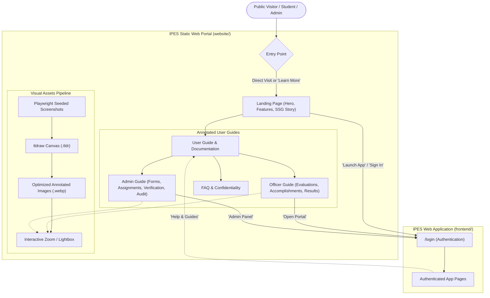
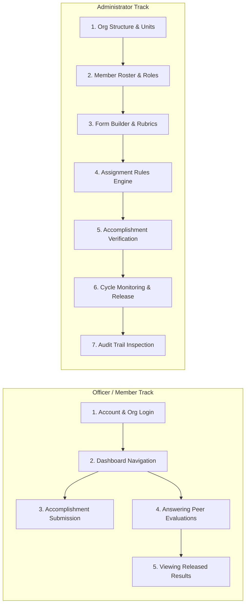
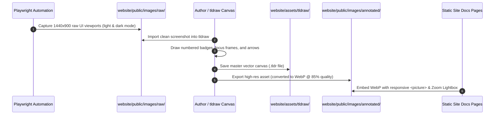

# Static Landing Page and Annotated User Guide Website Implementation Plan

**Author:** Rafael  
**Created:** 30 October 2026, Asia/Manila  
**Status:** Proposed implementation plan  
**Target Delivery:** Multi-phase rollout for public launch and documentation delivery  
**Repository Baseline:** `dev` (`fix/pending-queue-exclude-closed-forms` worktree)

---

## 1. Goal / Executive Summary

The **Individual Performance Evaluation System (IPES)** currently operates as an internal, authenticated single-page application (React 19 + Django 6.0). Visitors arriving at the root URL are immediately redirected to the login interface (`/login`), offering no context, introduction, or public explanation of what IPES is, who developed it (the CIT-U Supreme Student Government Committee on Research), or how it transforms peer evaluations. Furthermore, both student officers and administrators currently lack visual, step-by-step documentation on how to navigate evaluation cycles, configure assignment rules, submit accomplishment portfolios, and analyze performance metrics.

This project delivers a dedicated, high-performance **static website** serving dual purposes:
1. **Public Landing & Product Showcase**: A modern marketing and overview landing page explaining the mission, architecture, and benefits of IPES compared to legacy Google Forms and spreadsheets.
2. **Interactive Visual User Guide**: A comprehensive, role-segmented manual (Officers vs. Administrators) featuring **screenshots systematically annotated with numbered steps, bounding boxes, and arrows using tldraw**.

### High-Level Architecture & User Flow



---

## 2. Critical Items & Architectural Decisions

> [!IMPORTANT]
> **Isolated Subproject in `website/` (Decoupled from Frontend SPA)**  
> The static landing page and user guide will live in a standalone `website/` directory using **Astro with Starlight** (or VitePress). The existing `frontend/` is an authenticated application with deep state management, session cookies, and route guards. Keeping the static portal decoupled guarantees:
> - Zero impact on the main application's bundle size and load speed.
> - Instant pre-rendered static HTML with a 100/100 Lighthouse score.
> - Out-of-the-box offline/client-side fuzzy search (Pagefind) without backend search infrastructure.
> - Independent zero-cost hosting (e.g. GitHub Pages or Cloudflare Pages), with clear routing to the app (`app.ipes...` or `/app`).

> [!IMPORTANT]
> **Data Privacy & Synthetic Demo Seeding for Screenshots**  
> Under no circumstances will screenshots contain real student names, identification numbers, or actual evaluation remarks. All screenshots will be captured using a dedicated Playwright automation fixture (`scripts/capture-guide-screenshots.mjs`) running against an isolated PostgreSQL instance seeded with realistic, fictitious CIT-U student profiles, departments, and sample evaluation forms.

> [!IMPORTANT]
> **Version-Controlled tldraw Source Assets (`.tldr`)**  
> All annotated diagrams and callouts will be created and maintained as native `.tldr` vector files in `website/assets/tldraw/`. This guarantees that when the IPES interface evolves, arrows, text callouts, and numbered badges can be modified without redrawing the entire asset from scratch.

> [!WARNING]
> **Theme Parity (Light & Dark Mode)**  
> IPES features dynamic dark and light mode themes built with Mantine 9. The static website and its annotated screenshots must respect and reflect this design aesthetic, utilizing CIT-U gold/amber (`#F59E0B`), deep institutional navy (`#1B2A4A`), and high-contrast callout annotations visible across both themes.

---

## 3. Open Questions for User Clarification

| Item | Options | Proposed Recommendation |
|---|---|---|
| **Static Site Engine** | **Astro + Starlight** vs. **VitePress** vs. **Custom Vite React** | **Astro + Starlight**: Native markdown/MDX, built-in Pagefind search, zero client JS for static text, and full support for embedded React components. |
| **Domain / Routing Strategy** | 1. Subpath (`/` landing, `/docs` guide, `/app` dashboard)<br>2. Subdomains (`ipes.cit.edu` landing & docs, `app.ipes.cit.edu` app) | **Subpath routing in development**, flexible for either reverse proxy or subdomain in production. |
| **tldraw Workspace Mode** | 1. Standalone web canvas export (`.tldr` & `.webp`)<br>2. Embedded interactive tldraw canvas inside the docs | **Option 1 (Exported WebP with Lightbox)** for blazing performance and accessibility, keeping `.tldr` source files in the repo. |
| **Interactive Demo Preview** | Include interactive UI simulator or static cards? | Start with high-resolution annotated walkthrough cards; consider interactive mockups in Phase 5. |

---

## 4. Detailed Specification: Content & Structure

### 4.1 Landing Page Architecture (`website/src/pages/index.astro`)

The landing page provides an engaging, professional narrative introducing IPES to students, faculty, and administrators.

| Section | Content & Function |
|---|---|
| **1. Header & Navigation** | IPES logo, CIT-U SSG attribution, navigation links (`About`, `Features`, `Officer Guide`, `Admin Guide`, `Architecture`), Theme Toggle, and a prominent `Launch App` CTA. |
| **2. Hero Section** | - **Headline**: *"Modern, Automated Peer Evaluations for Student Organizations."*<br>- **Subheadline**: *"Designed by the CIT-U SSG Committee on Research. Eliminates spreadsheet chaos, automates form assignment, and delivers instant, actionable performance analytics."*<br>- **Action Buttons**: `Explore User Guides` (Primary), `Log In to IPES` (Secondary).<br>- **Visual Preview**: Isometric or browser-framed preview of the IPES Dashboard with animated metrics. |
| **3. The Problem vs. The Solution** | Interactive comparison matrix contrasting the legacy Google Forms workflow (manual sheet aggregation, lost submissions, opaque formulas) against IPES (rule-based auto-assignment, real-time analytics, immutable audit logs). |
| **4. Core Feature Matrix** | Four deep-dive feature blocks with micro-illustrations:<br>1. *Automated Rule-Based Distribution*<br>2. *Accomplishment Portfolio & Verification*<br>3. *Real-Time Multi-Dimensional Analytics*<br>4. *Enterprise-Grade Audit Trail & Security* |
| **5. How It Works (3 Steps)** | 1. **Setup**: Admins define units, positions, and evaluation criteria.<br>2. **Evaluate**: Officers complete assigned peer evaluations in an intuitive, distraction-free interface.<br>3. **Analyze**: Instant category breakdowns, percentiles, and actionable feedback once forms are released. |
| **6. Security & Confidentiality** | Clear explanation of peer evaluation anonymity, role-based access control, masked CSRF, and session protection. |
| **7. CIT-U SSG Committee on Research** | Mission statement, contributors, academic context, and open-source project links. |
| **8. Footer** | University links, repository links, documentation sitemap, copyright, and version tag. |

---

### 4.2 Comprehensive User Guide Catalog

The user guide is partitioned into two major learning tracks: **Officer / Member Track** and **Administrator Track**.



#### Detailed Chapter Outline & Required Visuals

##### Track 1: Officer / Member Instructions
1. **Getting Started & Organization Selection**
   - Logging in via credentials.
   - Selecting the active academic organization / term (`SelectOrganization.tsx`).
   - Switching between Member view and Admin view (for dual-role users).
   - *Screenshots*: Login screen, Organization card picker, Header organization switcher.
2. **Navigating the Officer Dashboard**
   - Understanding pending evaluation counters and deadlines.
   - Reading recent accomplishment status notifications.
   - *Screenshots*: Officer dashboard overview with highlighted summary cards.
3. **Submitting Accomplishment Portfolios**
   - Creating a new accomplishment entry (Title, Description, Date range, Verification URL/Google Drive proof).
   - Tracking status: `Pending Review` (yellow), `Verified` (green), `Rejected` (red with reviewer remarks).
   - Updating rejected entries with revised proof.
   - *Screenshots*: Accomplishment creation modal, Proof URL input, Status badges in the portfolio table.
4. **Completing Peer Evaluations**
   - Accessing assigned peer list (`Evaluations.tsx`).
   - Completing the 5-point Likert scale question matrix with category headers.
   - Writing constructive qualitative feedback (strengths, growth areas).
   - Saving drafts vs. final confirmation submission.
   - *Screenshots*: Assignment cards, Likert radio scale with criteria tooltips, Qualitative textarea, Final submission confirmation dialog.
5. **Viewing Individual Results & Feedback Analytics**
   - Accessing released evaluation cycles (`Results.tsx`).
   - Interpreting radar charts and category score breakdowns.
   - Reviewing aggregated, anonymized peer comments.
   - *Screenshots*: Individual score card, Performance radar chart, Anonymized feedback list.

##### Track 2: Administrator Instructions
1. **Configuring Organization Structure**
   - Defining Units / Committees (e.g., Committee on Research, Ways and Means).
   - Configuring Positions with organizational ranks (Rank 1 = Head/Chair).
   - *Screenshots*: Units management table, Add Unit drawer, Position rank ordering.
2. **Managing Members & Roles**
   - Inviting student officers and mapping them to Units and Positions.
   - Granting Administrator vs. Member permissions.
   - Activating and deactivating memberships (soft deletes).
   - *Screenshots*: User directory table, Membership edit modal, Role selection toggle.
3. **Evaluation Form Builder & Rubric Design**
   - Creating an evaluation cycle (Title, Academic Term, Start Date, End Date).
   - Managing Question Categories (e.g., "Leadership", "Technical Competence", "Collaboration").
   - Adding rating scale questions and custom qualitative feedback prompts.
   - Reordering questions via drag-and-drop (`dnd-kit`).
   - *Screenshots*: Form builder overview, Category accordion, Question editor modal, Drag-and-drop handle demonstration.
4. **Assignment Rules & Generation Engine**
   - Understanding declarative assignment rules:
     - *All to Head*: All unit members evaluate the unit head.
     - *Head to All*: Unit head evaluates all unit members.
     - *Peer-to-Peer*: Members within the same unit evaluate each other.
     - *Self-Evaluation*: Members evaluate themselves.
   - Previewing the generated assignment matrix before activation.
   - Handling manual assignment overrides.
   - *Screenshots*: Rule builder interface, Rule condition selectors, Generated assignment table with status indicators.
5. **Verifying Accomplishment Portfolios**
   - Inspecting submitted accomplishments from the Admin queue.
   - Reviewing submitted external proof links.
   - Approving or Rejecting with mandatory constructive feedback.
   - *Screenshots*: Admin accomplishment review table, Verification dialog with external link button and rejection reason input.
6. **Monitoring Progress & Releasing Results**
   - Live tracking of cycle completion rates (Pending vs. In Progress vs. Completed).
   - Identifying delinquent evaluators.
   - Form state transitions: `Draft` → `Active` → `Closed` → `Released`.
   - Triggering score aggregation and result release.
   - *Screenshots*: Cycle progress bar, Evaluator status checklist, "Release Results" modal warning.
7. **Audit Log Inspection & Security**
   - Filtering audit entries by Actor, Action (Login, Form Created, Verified, Result Released), and Date range.
   - Viewing IP addresses and event metadata.
   - *Screenshots*: Audit log search interface, JSON metadata inspector modal.

---

## 5. Visual Annotation Pipeline Using tldraw

To achieve crystal-clear, professional documentation, all screenshots will follow a standardized visual annotation workflow using **tldraw**.

### 5.1 Design & Annotation Standards

```
┌────────────────────────────────────────────────────────────────────────┐
│  tldraw Visual Annotation Standards:                                   │
│                                                                        │
│  1. Numbered Badges:  Filled circles (1, 2, 3) in Electric Violet      │
│     (#8B5CF6) with crisp white sans-serif numbers.                     │
│                                                                        │
│  2. Directional Arrows: Hand-drawn or smooth vector curve pointing     │
│     from numbered badges directly to the focal button or input field.   │
│                                                                        │
│  3. Bounding Highlight: 2.5px rounded rectangle enclosing target       │
│     elements (#F59E0B Amber for actions, #06B6D4 Cyan for displays).   │
│                                                                        │
│  4. Explanatory Callout: Dark pill badge with high-contrast text       │
│     explaining critical fields (e.g. "Select evaluation term").        │
└────────────────────────────────────────────────────────────────────────┘
```

### 5.2 Step-by-Step Asset Production Workflow



1. **Automated Screen Capture**:  
   Run `npm run capture:docs` in `frontend/` (using a customized Playwright script). This launches the frontend with an isolated seeded test database, systematically visits every page, sets viewport size to `1440x900` at `2x` device pixel ratio, and outputs pristine raw PNGs into `website/public/images/raw/`.
2. **tldraw Annotation**:  
   Import the screenshot into the tldraw workspace. Apply standardized callout elements:
   - Badge `(1)`: Where to click first.
   - Badge `(2)`: Data input or selection step.
   - Badge `(3)`: Final submission or verification trigger.
3. **Asset Export & Optimization**:  
   - Save the project state: `website/assets/tldraw/{track}/{step-name}.tldr`.
   - Export WebP graphic: `website/public/images/annotated/{track}/{step-name}.webp`.
   - Run compression check to ensure all images remain under 200 KB without visual degradation.
4. **Site Integration with Interactive Lightbox**:  
   Images in the user guide are wrapped in an accessible zoom component (e.g., `medium-zoom` or Starlight image zoom) allowing users to click and examine full-resolution UI details without leaving the page.

---

## 6. Phased Implementation Roadmap

To ensure high quality, stability, and careful execution, the implementation is partitioned into six clear phases:

### Phase 1: Architecture, Scaffolding & Tooling Setup
- Initialize the `website/` workspace using **Astro 5 + Starlight**.
- Configure typography (Inter / Geist Sans), CIT-U brand colors (navy `#1B2A4A`, gold `#F59E0B`), and responsive layout.
- Configure asset folders (`website/public/images/raw/`, `website/public/images/annotated/`, `website/assets/tldraw/`).
- Configure Starlight navigation sidebar with separate Officer and Admin categories.
- Set up root npm workspace scripts for unified local development.

### Phase 2: Landing Page Development (`website/`)
- Implement responsive landing page layout:
  - Hero section with animated badge, headline, and CTA triggers.
  - Interactive "Legacy vs. IPES" comparison table.
  - Four core feature showcase cards.
  - Workflow walkthrough section (Setup → Evaluate → Results).
  - Security, anonymity, and institutional credibility section.
  - University and SSG footer.
- Test responsive layouts across mobile (375px), tablet (768px), and desktop (1440px).

### Phase 3: Automated Screenshot Capture & tldraw Asset Production
- Write `frontend/scripts/capture-guide-screenshots.mjs` leveraging the existing Playwright harness.
- Seed demo dataset:
  - 1 Organization: *"CIT-U Supreme Student Government"*
  - 3 Committees/Units: *"Executive Board"*, *"Committee on Research"*, *"Ways and Means"*
  - 6 Fictional student members with appropriate unit positions.
  - 1 Active evaluation cycle with categories and questions.
  - Sample submitted accomplishments with pending/verified states.
- Execute capture script to produce complete set of raw UI screenshots.
- Execute tldraw annotation workflow for all 12 key user journeys.
- Export and optimize annotated WebP graphics.

### Phase 4: User Guide Documentation Authoring
- Author all Officer / Member markdown guides (`website/src/content/docs/officer/...`).
- Author all Administrator markdown guides (`website/src/content/docs/admin/...`).
- Embed annotated screenshots with callouts matching the numbered prose steps.
- Implement accessible image zoom / modal lightbox for all screenshots.
- Add tips, callouts (`[!TIP]`, `[!IMPORTANT]`, `[!NOTE]`), and FAQ troubleshooting notes.

### Phase 5: App Integration, Cross-Linking & Navigation
- In `frontend/src/components/layout/Header.tsx`, add a **"Help & User Guide"** link pointing to the static website.
- In `frontend/src/pages/Index.tsx`, add an optional quick link to the public landing page.
- In `website/src/pages/index.astro` and docs headers, link the **"Launch App"** button directly to the IPES login portal.
- Verify cross-origin cookies and ensure smooth transitions between the static portal and authenticated app.

### Phase 6: Automated Testing, Accessibility, SEO & Deployment
- Run Pagefind search indexing and verify all keywords (e.g. "Likert", "accomplishment", "assignment rule") resolve accurately.
- Perform Lighthouse audit (target: 95+ Performance, 100 Accessibility, 100 Best Practices, 100 SEO).
- Configure GitHub Actions deployment workflow (`.github/workflows/deploy-website.yml`) to automatically build and deploy the static website to GitHub Pages or Cloudflare on push to `main`.
- Update project root `README.md` and `docs/README.md` to reference the new public website and guides.

---

## 7. Proposed Changes

### Component 1: Static Website Subproject (`website/`)

#### [NEW] [website/package.json](file:///C:/Users/Rafael/.gemini/antigravity/worktrees/IPES/feat-static-website-and-guides/website/package.json)
Manifest for the static site subproject, including Astro, `@astrojs/starlight`, `@astrojs/tailwind`, `lucide-react`, and image optimization tools.

#### [NEW] [website/astro.config.mjs](file:///C:/Users/Rafael/.gemini/antigravity/worktrees/IPES/feat-static-website-and-guides/website/astro.config.mjs)
Astro and Starlight configuration specifying site title, CIT-U branding, custom CSS, sidebar navigation structure, and search settings.

#### [NEW] [website/tailwind.config.mjs](file:///C:/Users/Rafael/.gemini/antigravity/worktrees/IPES/feat-static-website-and-guides/website/tailwind.config.mjs)
Tailwind CSS configuration sharing theme color definitions (navy `#1B2A4A`, gold `#F59E0B`, slate neutrals) with the main frontend app.

#### [NEW] [website/src/styles/custom.css](file:///C:/Users/Rafael/.gemini/antigravity/worktrees/IPES/feat-static-website-and-guides/website/src/styles/custom.css)
Custom CSS styling for Starlight documentation overrides, callout styling, and image zoom behavior.

#### [NEW] [website/src/pages/index.astro](file:///C:/Users/Rafael/.gemini/antigravity/worktrees/IPES/feat-static-website-and-guides/website/src/pages/index.astro)
The official public landing page featuring Hero, Problem/Solution, Features, Workflow, and Footer.

#### [NEW] [website/src/components/LandingHero.astro](file:///C:/Users/Rafael/.gemini/antigravity/worktrees/IPES/feat-static-website-and-guides/website/src/components/LandingHero.astro)
High-impact hero component with action buttons, animated indicators, and preview showcase.

#### [NEW] [website/src/components/ComparisonTable.astro](file:///C:/Users/Rafael/.gemini/antigravity/worktrees/IPES/feat-static-website-and-guides/website/src/components/ComparisonTable.astro)
Side-by-side interactive visual comparison: Legacy Google Forms vs. IPES Platform.

#### [NEW] [website/src/components/ZoomableImage.astro](file:///C:/Users/Rafael/.gemini/antigravity/worktrees/IPES/feat-static-website-and-guides/website/src/components/ZoomableImage.astro)
Custom image wrapper with click-to-zoom modal and caption support for annotated screenshots.

#### [NEW] [website/src/content/docs/index.mdx](file:///C:/Users/Rafael/.gemini/antigravity/worktrees/IPES/feat-static-website-and-guides/website/src/content/docs/index.mdx)
Documentation portal introduction and role-selection guide.

#### [NEW] [website/src/content/docs/officer/getting-started.md](file:///C:/Users/Rafael/.gemini/antigravity/worktrees/IPES/feat-static-website-and-guides/website/src/content/docs/officer/getting-started.md)
Officer instruction chapter: Logging in, selecting organization, and dashboard orientation.

#### [NEW] [website/src/content/docs/officer/accomplishments.md](file:///C:/Users/Rafael/.gemini/antigravity/worktrees/IPES/feat-static-website-and-guides/website/src/content/docs/officer/accomplishments.md)
Officer instruction chapter: Submitting portfolio accomplishments with proof links and tracking status.

#### [NEW] [website/src/content/docs/officer/evaluations.md](file:///C:/Users/Rafael/.gemini/antigravity/worktrees/IPES/feat-static-website-and-guides/website/src/content/docs/officer/evaluations.md)
Officer instruction chapter: Completing assigned peer evaluations, Likert ratings, and qualitative feedback.

#### [NEW] [website/src/content/docs/officer/results.md](file:///C:/Users/Rafael/.gemini/antigravity/worktrees/IPES/feat-static-website-and-guides/website/src/content/docs/officer/results.md)
Officer instruction chapter: Understanding released scorecards, radar charts, and anonymous feedback.

#### [NEW] [website/src/content/docs/admin/organization-setup.md](file:///C:/Users/Rafael/.gemini/antigravity/worktrees/IPES/feat-static-website-and-guides/website/src/content/docs/admin/organization-setup.md)
Admin instruction chapter: Setting up units, committees, positions, and ranks.

#### [NEW] [website/src/content/docs/admin/members-and-roles.md](file:///C:/Users/Rafael/.gemini/antigravity/worktrees/IPES/feat-static-website-and-guides/website/src/content/docs/admin/members-and-roles.md)
Admin instruction chapter: Member roster management, role delegation, and activation.

#### [NEW] [website/src/content/docs/admin/form-builder.md](file:///C:/Users/Rafael/.gemini/antigravity/worktrees/IPES/feat-static-website-and-guides/website/src/content/docs/admin/form-builder.md)
Admin instruction chapter: Form creation, rubrics, question categories, and question ordering.

#### [NEW] [website/src/content/docs/admin/assignment-rules.md](file:///C:/Users/Rafael/.gemini/antigravity/worktrees/IPES/feat-static-website-and-guides/website/src/content/docs/admin/assignment-rules.md)
Admin instruction chapter: Assignment rules engine, evaluator-to-evaluatee mapping, and matrix preview.

#### [NEW] [website/src/content/docs/admin/accomplishment-verification.md](file:///C:/Users/Rafael/.gemini/antigravity/worktrees/IPES/feat-static-website-and-guides/website/src/content/docs/admin/accomplishment-verification.md)
Admin instruction chapter: Reviewing submitted portfolio proof, approving, and rejecting with feedback.

#### [NEW] [website/src/content/docs/admin/cycle-management.md](file:///C:/Users/Rafael/.gemini/antigravity/worktrees/IPES/feat-static-website-and-guides/website/src/content/docs/admin/cycle-management.md)
Admin instruction chapter: Tracking completion rates, closing cycles, and releasing results.

#### [NEW] [website/src/content/docs/admin/audit-logs.md](file:///C:/Users/Rafael/.gemini/antigravity/worktrees/IPES/feat-static-website-and-guides/website/src/content/docs/admin/audit-logs.md)
Admin instruction chapter: Audit log inspection, actor filtering, and compliance verification.

#### [NEW] [website/src/content/docs/faq.md](file:///C:/Users/Rafael/.gemini/antigravity/worktrees/IPES/feat-static-website-and-guides/website/src/content/docs/faq.md)
Frequently asked questions regarding peer anonymity, cycle deadlines, and troubleshooting.

---

### Component 2: Screenshot Automation & Assets

#### [NEW] [frontend/scripts/capture-guide-screenshots.mjs](file:///C:/Users/Rafael/.gemini/antigravity/worktrees/IPES/feat-static-website-and-guides/frontend/scripts/capture-guide-screenshots.mjs)
Playwright script automating viewport setup, database fixture authentication, page visits, and clean screenshot extraction into `website/public/images/raw/`.

#### [NEW] [website/assets/tldraw/](file:///C:/Users/Rafael/.gemini/antigravity/worktrees/IPES/feat-static-website-and-guides/website/assets/tldraw/)
Directory storing all version-controlled `.tldr` source annotation project files.

#### [NEW] [website/public/images/annotated/](file:///C:/Users/Rafael/.gemini/antigravity/worktrees/IPES/feat-static-website-and-guides/website/public/images/annotated/)
Directory containing all final compressed `.webp` annotated graphics embedded across documentation chapters.

---

### Component 3: IPES Application Integration & CI/CD

#### [MODIFY] [frontend/src/components/layout/Header.tsx](file:///C:/Users/Rafael/.gemini/antigravity/worktrees/IPES/feat-static-website-and-guides/frontend/src/components/layout/Header.tsx)
Add an accessible "User Guide & Help" external icon button / menu link pointing directly to the static documentation portal.

#### [MODIFY] [README.md](file:///C:/Users/Rafael/.gemini/antigravity/worktrees/IPES/feat-static-website-and-guides/README.md)
Update the root repository README with a prominent link to the live static landing page and interactive documentation.

#### [NEW] [.github/workflows/deploy-website.yml](file:///C:/Users/Rafael/.gemini/antigravity/worktrees/IPES/feat-static-website-and-guides/.github/workflows/deploy-website.yml)
GitHub Actions workflow that builds the Astro static website, generates the Pagefind search index, and deploys artifacts to GitHub Pages on release merges.

---

## 8. Verification Plan

### Automated Tests & Quality Gates

| Check | Command | Success Criteria |
|---|---|---|
| **Static Site Build** | `npm --prefix website run build` | Compiles static HTML, optimizes assets, and generates Pagefind search index without errors. |
| **Markdown / Link Audit** | `npx --yes lychee "website/dist/**/*.html"` | Zero broken internal anchors or dead outbound links. |
| **Frontend Test Suite** | `npm --prefix frontend run test` | All existing Vitest component tests pass without regression. |
| **Backend Test Suite** | `python backend/manage.py test` | All backend tests pass on isolated PostgreSQL. |
| **Frontend Lint & Types** | `npm --prefix frontend run lint` & `npx tsc -p frontend/tsconfig.app.json --noEmit` | Clean type-checking and zero ESLint errors. |
| **Performance & SEO Audit** | Lighthouse CI / Chrome DevTools MCP | Performance ≥ 95, Accessibility = 100, Best Practices = 100, SEO = 100. |

### Manual Verification Checklist

1. **Landing Page Responsive Design & Visuals**:
   - Verify layout rendering on mobile (375px), tablet (768px), and full desktop (1440px).
   - Toggle dark/light theme and verify contrast of headings, cards, and CTA buttons.
   - Verify that clicking `Launch App` / `Sign In` correctly navigates to the IPES `/login` page.
2. **User Guide Flow & Navigation**:
   - Browse through all Officer chapters and verify clarity of step-by-step instructions.
   - Browse through all Administrator chapters and verify accuracy of form builder, assignment rules, and result release instructions.
   - Test client-side fuzzy search by typing queries (e.g., "Likert", "Verification", "Rules") and verifying instantaneous, relevant results.
3. **Annotated Screenshot Verification**:
   - Inspect every embedded screenshot: verify that all arrows, highlight boxes, and numbered badges align with the referenced UI elements.
   - Click each screenshot to ensure the zoom modal opens smoothly and displays crisp, readable UI text without pixelation.
   - Confirm that no real student data or sensitive credentials appear anywhere in the imagery.
4. **App Cross-Navigation**:
   - From inside the authenticated IPES app (both Officer and Admin dashboards), click the "Help & User Guide" link in the header. Confirm it opens the static guide in a new tab without interrupting active app state or session.
