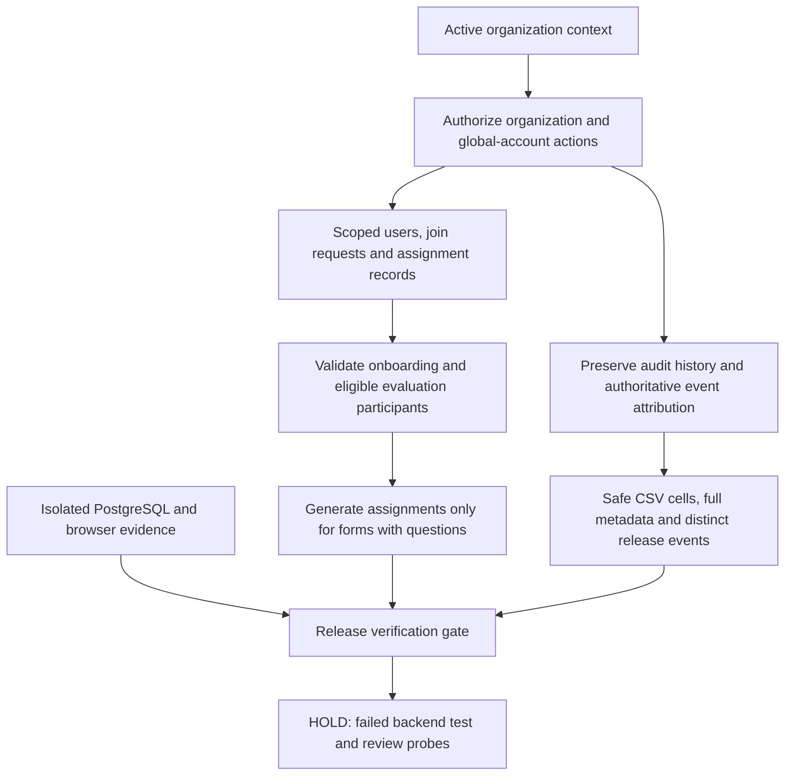
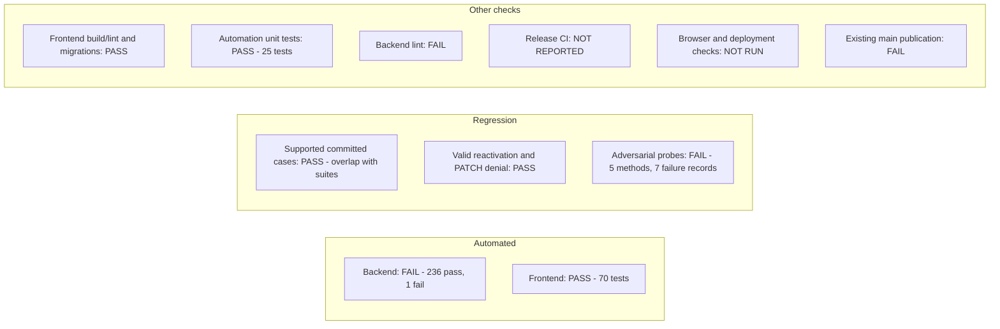

<!-- Proposed title: Release tenant security and reliability (2026-10-30) -->

## 🚀 Release — tenant security and reliability (2026-10-30)

> Promotes `dev` → `main`. Lists the changes proposed for production.
>
> **HOLD — pre-release verification is failing.** This description is prepared for publication after the blockers below are resolved. Reviewed head: `c89460e65133daee8b422555115547476d791e1d`; main: `3a698d68fe3082cb4565c33e0727797ec337f79d` (56 commits, 102 changed files).

This release restricts tenant administrators' access to global accounts and other organizations' data, protects individual evaluation results and organization audit history, and strengthens assignment eligibility, onboarding and audit behavior. It also introduces isolated PostgreSQL testing and browser evidence tooling.

## Change overview

The tenant, account, evaluation and audit changes are included in dev. Passing local frontend tests do not clear the failed release gate.

### Outstanding release blockers

- **Audit metadata exposure:** `GET /api/audit/actions/` returns all tenants' full action strings to unrelated authenticated users. The endpoint bypasses the scoped queryset; the audit-read work for #268 remains incomplete.
- **Membership access bypass:** POST re-adding an inactive assignment directly reactivates it without serializer validation, including when the user's organization role is revoked. #272 remains incomplete.
- **Date validation:** calendar-invalid dates and maximum-date overflow still return HTTP 500 instead of 400. #266 remains incomplete.
- **Search regression:** audit list `q` filtering was removed; a nonexistent keyword still returns records.
- **Backend suite failure:** the reactivation signal test creates a form without questions but expects an assignment, conflicting with the readiness guard. Correct that fixture without weakening the guard.
- **CI evidence:** all 21 corresponding PRs have empty check rollups; the reviewed dev head has no reported validation runs/checks.
- **Existing release automation failure:** [Release Please on current main](https://github.com/CIT-U-Computer-Students-Society/IPES/actions/runs/40901951786) fails with `Resource not accessible by integration` during publication. Resolve/recover it separately.

**Issue-closing caution:** promoted commit messages already carry closing references for #266, #268 and #272. Leaving these issues out of the PR's closing list does not prevent closure when those commits reach main. Complete their fixes before promotion.

---

## 🐛 Bug Fixes

These are the fix commit subjects in the promotion; the blocker list above identifies incomplete behavior.

- require active organization role for positional memberships
- make join request approval atomic and validate role choices
- scope audit read endpoints and hooks by active organization
- record distinct audit action on results release
- enforce required question existence guard during membership auto assignment
- exclude revoked and inactive members from assignment generation
- allow re-adding and reactivating inactive position assignments
- validate filter parameters and include full end date
- attribute audit events to authoritative organization
- count completed evaluation assignments using backend status
- enforce configured password validators
- neutralize spreadsheet formula injection in CSV exports
- preserve full event metadata
- isolate failed audit inserts
- scope membership details to the active organization
- restrict global account management
- require active join request administrators
- isolate join requests by tenant
- authorize organization updates
- protect organization audit history
- protect individual assignment results

### Issues supported by the release review

The following fixes have supporting code and passing relevant regression evidence. #233, #241, #252, #253 and #260 are already closed on GitHub; their references record the fixes being promoted.

Fixes #233

Fixes #235

Fixes #238

Fixes #240

Fixes #241

Fixes #248

Fixes #252

Fixes #253

Fixes #254

Fixes #255

Fixes #256

Fixes #257

Fixes #260

Fixes #261

Fixes #262

Fixes #263

Fixes #267

Fixes #270

Fixes #271

Fixes #278

No closing reference is included for #266, #268 or #272 because the targeted review found incomplete behavior. Other open issues are outside the supported fix list; organization-update logging alone does not complete #277.

## 📝 Documentation

- plan PostgreSQL and Playwright testing rollout
- define concise requirements traceability matrix

## 🧪 Tests

- add Playwright requirements and evidence pipeline
- add seeded E2E support and database evidence

## ⚙️ CI / Tooling

- provision isolated PostgreSQL test environments

📦 Dependency Updates (6 bumps)

- update django requirement in /backend
- bump @lottiefiles/dotlottie-react in /frontend
- bump react-hook-form from 7.86.0 to 7.91.0 in /frontend
- bump typescript from 6.0.3 to 7.0.2 in /frontend
- bump postcss from 8.5.31 to 8.5.32 in /frontend
- bump react from 19.3.0 to 19.3.1 in /frontend

---

## ✅ Pre-Release Verification

- [ ] `python manage.py test` — all backend tests pass (**FAIL: 1 of 237**)
- [x] `npm run test` — all frontend tests pass (**70 tests**, run once with `-- --run`)
- [ ] No regressions observed on the dev environment (targeted probes found defects; deployed UI smoke testing was not run)
- [x] Local dev matches origin/dev at the reviewed revision
- [x] Reviewed issue-to-PR mappings and confirmed all 21 fix PR heads are included in dev
- [ ] Targeted review findings resolved
- [ ] Required release CI results inspected and passing

### Testing evidence

Tested on Windows with the activated backend virtual environment and isolated native PostgreSQL 18.1 at localhost:55432. The restricted test role and test-instance marker were validated. Each database-backed run used a separate disposable database. CI config uses PostgreSQL 17. Results below apply to the reviewed revision; rerun affected checks after fixes.

| Category | Suite or scenario | Command or steps | Result | Evidence |
|---|---|---|---|---|
| Automated | Full backend suite | backend: activate virtualenv; `IPES_TEST_PORT=55432`; `python manage.py test --verbosity 2` | **FAIL** | 237 tests: 236 pass, 1 failure, no skips; 99.748 s. Failing test: `MembershipReactivationTests.test_reactivation_triggers_auto_assignment_generation`. |
| Automated | Full frontend suite | frontend: `npm run test -- --run` | **PASS** | 70 tests in 14 files; exit 0. |
| Regression | Supported issue fixes | Committed regression tests for assignment confidentiality/eligibility/readiness, organization authorization/deletion, join isolation/authority/atomicity, account privacy/password policy, audit resilience/metadata/attribution/CSV/date bounds and dashboard completions | **PASS for named cases** | Included in the suites above; counts are not added again. The vulnerable baseline was not re-run in this review. |
| Regression | Valid membership reactivation with a question-bearing form; revoked access via PATCH | Temporary review probes using APIClient and isolated PostgreSQL | **PASS** | 2 review methods pass. Ready-form reactivation reuses the membership and generates the expected assignment. |
| Regression | Audit action access, invalid dates, list search and revoked-member POST reactivation | `python manage.py test release_review_probes.ReleaseAuditReviewProbes release_review_probes.ReleaseMembershipReviewProbes --verbosity 2` with the temporary module on PYTHONPATH | **FAIL** | 7 methods total: 2 pass, 5 fail; runner reports 7 failures because invalid-date coverage includes 3 failing subtests. Outsider receives foreign event metadata, invalid dates return 500, nonmatching search returns an event, revoked-member re-add returns 201. |
| Other checks | Frontend build | `npm run build` | **PASS** | Exit 0; large-chunk warning. |
| Other checks | Frontend lint | `npm run lint` | **PASS** | 0 errors, 2 Fast Refresh warnings. |
| Other checks | Backend lint | `flake8 . --exclude=.venv,.codex-tests,.e2e` | **FAIL** | 1,199 diagnostic lines; no baseline comparison performed. |
| Other checks | Migration consistency | Test settings and port 55432; `python manage.py makemigrations --check --dry-run` | **PASS** | No changes detected. |
| Other checks | Release/sync automation tests | `node --test .github/scripts/*.test.cjs` | **PASS** | 25 tests, no failures/skips. |
| Other checks | Actual GitHub CI | Read check rollups for all 21 corresponding PRs, plus commit statuses/checks/workflow runs on reviewed head | **NOT REPORTED** | Empty results; no validation pass established. Workflow configuration alone is not execution evidence. |
| Other checks | Playwright and deployed UI / production smoke checks | Not executed during this review | **NOT RUN** | Browser pipeline exists in this promotion; no local browser or deployment result is claimed. |
| Other checks | Existing main Release Please publication | Inspect run 40901951786 | **FAIL** | [Publication job](https://github.com/CIT-U-Computer-Students-Society/IPES/actions/runs/40901951786) reports Resource not accessible by integration; separate from dev validation. |

For #270, the review exercised invalid-input/state/success tests and inspected the transaction and row-lock implementation. It did not separately run competing approve/reject transactions or injected-failure rollback. Django also emitted an unordered organization pagination warning.

### Testing charts

## Type of change

- [ ] New feature (non-breaking change which adds functionality)
- [x] Bug fix (non-breaking change which fixes an issue)
- [x] Breaking change (global account management becomes platform-only; generic join-request mutations and organization DELETE are unavailable; organization writes require active tenant administrator context)
- [ ] Refactor (changes that do not add functionality or fix a bug)
- [x] This change requires a documentation update (testing setup, rollout plan and traceability documentation included)
