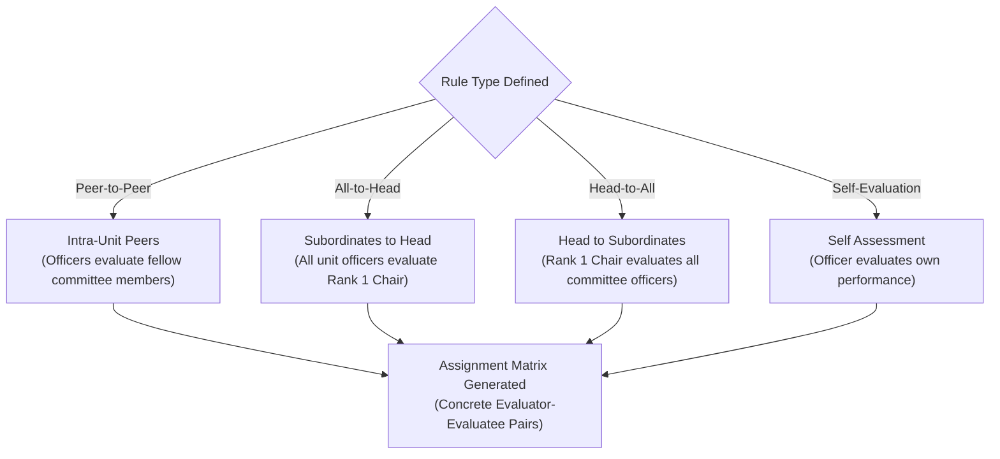

One of IPES's most powerful capabilities is the **Assignment Rules Engine** (`/admin/assignments`). Instead of manually matching pairs or generating individualized Google Form links, administrators establish declarative rules.

When the evaluation cycle transitions to **Active**, IPES parses these rules against your active membership roster and automatically generates all concrete evaluator-evaluatee pairs.

---

## 1. Rule Types & Previewing the Matrix

### Assignment Rule Evaluation Flow

### Rule Archetypes

1. 1 **Rule Configuration**:
   - **Peer-to-Peer (`PEER`)**: Members in the same committee evaluate each other (excluding self unless specified).
   - **All-to-Head (`ALL_TO_HEAD`)**: All unit members evaluate their committee chair (Rank 1).
   - **Head-to-All (`HEAD_TO_ALL`)**: Unit head evaluates all subordinate members in their committee.
   - **Self-Evaluation (`SELF`)**: Members complete a reflective assessment of their own performance.

2. 2 **Matrix Preview Table**:
   - Recalculates and displays all generated evaluator-to-evaluatee pairs (e.g. 48 Total Pairs) so administrators can verify coverage before cycle activation.

:::caution[Verify Before Activating]
Always verify the matrix preview to ensure every officer has appropriate evaluatees assigned before launching the cycle.
:::

Next, learn how to manage the [Accomplishment Verification Queue](/IPES/admin/accomplishment-verification/).
