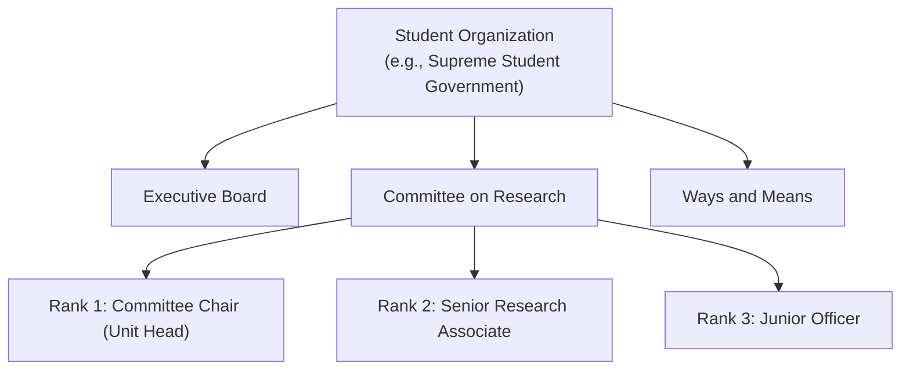

As an IPES Administrator, your first responsibility in preparing an evaluation cycle is defining your organization's structural hierarchy. IPES models student organizations through **Units** (committees or departments) and **Positions** (ranked roles within each unit).

Navigate to **Organization Settings** (`/admin/organization`) to configure these elements.

---

## 1. Managing Units (Committees) & Ranked Positions

Units represent functional subdivisions within your student body (e.g., *"Executive Board"*, *"Committee on Research"*, *"Ways and Means"*).

### Structural Hierarchy Model

### Key Setup Actions

1. 1 **Add Unit**: Click to open the committee creation drawer and specify the unit name and description.
2. 2 **Hierarchy Rank 1 (Unit Head)**:
   - **Rank 1**: Designates the **Unit Head** (Committee Chair, Director, or Lead). This rank is critical for automated evaluation rules such as *All-to-Head* or *Head-to-All*.
   - **Rank 2+**: Designates subordinate committee officers in order of seniority.

:::note[Soft Deletes]
IPES enforces **soft deletes**. Deleting a unit deactivates it without deleting historical evaluation assignments or audit records from prior academic terms.
:::

Next, learn how to invite and manage [Members & Role Permissions](/IPES/admin/members-and-roles/).
