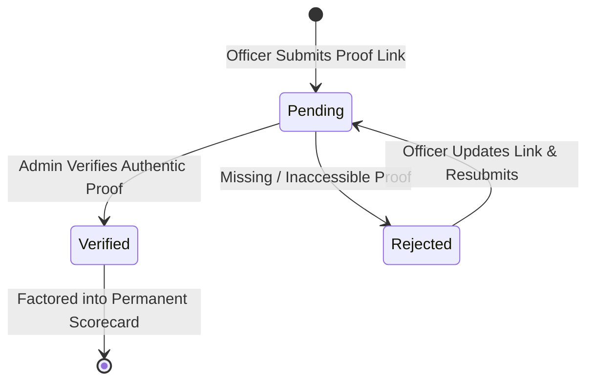

In IPES, peer evaluations are paired with tangible achievements. The **Accomplishment Portfolio** (`/member/accomplishments`) allows you to log key milestones, events organized, documents drafted, or initiatives led during the academic term.

When administrators review an evaluation cycle, these verified accomplishments provide crucial context for performance assessments.

---

## Logging a New Accomplishment

To add an accomplishment to your portfolio, click the **+ Add Accomplishment** button on the top right of the page:

### Form Fields

1. 1 **Accomplishment Title**: A clear, concise title summarizing your contribution (e.g., *"CIT-U Research Colloquium Presentation"*). Specify the associated competency category and activity date range.
2. 2 **Verification Proof Link**: A direct hyperlink verifying your achievement (e.g. Google Drive shared folder, repository, meeting minutes). Ensure permissions are set so administrators can view the document.
3. 3 **Submit Proof**: Saves the entry and places it into the administrator's review queue.

:::caution[Public Link Permissions]
Ensure permissions on Google Drive or external proof links are set to *"Anyone with the link can view"* so administrators can inspect your documentation without permission errors.
:::

---

## Understanding Verification Statuses

Your submitted accomplishments are displayed in a clean tabular view with status badges:

| Status Badge | Meaning | Action Required |
|---|---|---|
| **Pending Review** (Amber) | Submitted and awaiting administrator inspection | None. Your admin will review the link and documentation. |
| **Verified** (Green) | Approved by an administrator as authentic | None. This item is officially logged and factored into your record. |
| **Rejected** (Red) | Not approved due to missing proof or insufficient detail | Click the item to read the administrator's rejection remarks, update your proof link, and resubmit. |

Next, learn how to complete [Peer Evaluations](/IPES/officer/evaluations/).
