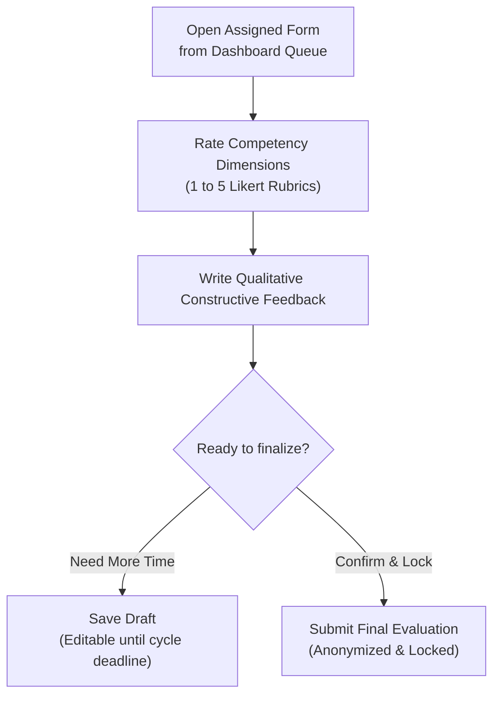

When an evaluation cycle is active, you are assigned specific fellow officers to evaluate according to your organization's assignment rules.

Navigate to **Evaluations** (`/member/evaluations`) or click **Start Form** from your dashboard queue.

---

## The Evaluation Form Interface

### Evaluation Submission Flow

### Rating Criteria

1. 1 **5-Point Likert Rating Scale**:
   - **1 — Unsatisfactory**: Consistently fails to meet basic role expectations.
   - **2 — Needs Improvement**: Meets some requirements but requires frequent supervision.
   - **3 — Satisfactory**: Reliably meets role expectations with good quality.
   - **4 — Very Good**: Exceeds standard expectations; demonstrates proactive ownership.
   - **5 — Outstanding**: Exceptional impact, inspirational leadership, and exemplary execution.
   
2. 2 **Constructive Qualitative Feedback**:
   - Provide concrete examples of strengths and actionable suggestions for growth. Feedback is aggregated anonymously to encourage genuine professional development.

3. 3 **Final Submission**:
   - Click **Save Draft** to store your progress and return later.
   - Click **Submit Final Evaluation** to finalize your assessment.

:::caution[Submission Locking]
Once an evaluation is submitted, the record is permanently locked to preserve evaluation integrity. If you made a critical error before the cycle closes, notify your administrator immediately.
:::

Next, learn how to interpret your [Evaluation Results](/IPES/officer/results/).
