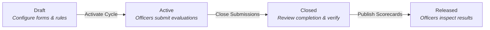

## Executive Overview

The **Individual Performance Evaluation System (IPES)** is a full-stack web application conceived and developed by the **Committee on Research** of the **CIT-U Supreme Student Government (SSG)**.

Periodic individual performance evaluation is a cornerstone of student leadership governance at CIT-University. It provides student leaders, committee heads, and executive officers with candid, multidirectional feedback regarding their contributions, work ethic, leadership quality, and collaboration skills.

Before IPES, this process was conducted through standalone Google Forms and spreadsheets. While functional for small teams, scaling Google Forms across dozens of student committees and hundreds of officers introduced substantial administrative friction, delayed result turnaround times, and compromised response privacy.

IPES digitizes this entire process from end to end.

---

## The Evaluation Lifecycle

IPES organizes performance assessment into distinct evaluation cycles. Each cycle progresses through four immutable state transitions:

1. **Draft State**: Administrators configure the evaluation cycle, author question categories and Likert rubrics, and define rule sets mapping which members evaluate each other.
2. **Active State**: The form opens for completion. The system generates individualized assignment queues for each member. Officers complete their assigned evaluations and submit accomplishment portfolios.
3. **Closed State**: The deadline passes and form submissions are locked. Administrators review completion rates, verify outstanding accomplishment submissions, and inspect response tallies.
4. **Released State**: Scores, category breakdowns, radar charts, and anonymized peer feedback comments are computed and published to individual officer dashboards.

---

## Core System Capabilities

### 1. Dynamic Assignment Rules Engine
Instead of manually distributing individual links, administrators write declarative assignment rules based on organizational hierarchy:
- **Peer-to-Peer**: Every member within a committee or unit evaluates all other members in that unit.
- **Member-to-Head**: All members evaluate their respective unit chair or committee head.
- **Head-to-Member**: Unit heads evaluate their committee members.
- **Self-Evaluation**: Members complete a reflective assessment of their own performance.

### 2. Accomplishment Portfolio with Verification
Evaluations are grounded in verifiable performance. Members submit their achievements throughout the academic term—including event leadership, documents drafted, or initiatives executed—accompanied by proof links (such as Google Drive folders or documentation). Administrators verify these accomplishments, which are then accessible as context during evaluation.

### 3. Real-Time Analytics & Radar Visualizations
Upon cycle release, officers and administrators view clear, multidimensional visualizations:
- Overall composite performance index (1.00 - 5.00).
- Performance radar charts showing strengths across competency dimensions (e.g., Leadership, Execution, Reliability, Communication).
- Statistical percentile ranking relative to the organization or unit.
- Anonymized constructive qualitative comments.

### 4. Enterprise-Grade Audit Trail & Security
To ensure organizational trust and prevent tampering:
- Every administrative action (form modification, user role escalation, accomplishment rejection/approval, and result release) is permanently recorded in an append-only audit trail.
- Requests are strictly isolated by organization (`X-Organization-Id`), guaranteeing zero data leakage across different student bodies or departments.
- Strict database-level anonymity prevents evaluators' identities from being tied to specific scores or qualitative remarks in released reports.

---

## Getting Started

Ready to explore how to use IPES? Select your user track:

- **[Officer & Member Instructions](/officer/getting-started/)**: For student officers answering evaluations and submitting accomplishments.
- **[Administrator Instructions](/admin/organization-setup/)**: For committee heads and org admins managing the evaluation cycles.
