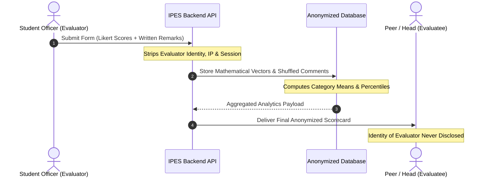

Honest, objective peer evaluation requires psychological safety. When student officers fear that candid constructive criticism will damage personal relationships or invite social retaliation, evaluation scores inflate artificially and lose their governance value.

IPES was architected from the ground up by the **CIT-U SSG Committee on Research** to guarantee **peer confidentiality**.

---

## How IPES Enforces Anonymity

### 1. Database-Level Anonymization
In released scorecards and analytics views, the system mathematically decouples the **Evaluator** from individual rating scores and qualitative remarks. 

When a member opens their performance scorecard:
- Numerical ratings are presented solely as category averages and weighted composite scores.
- Qualitative remarks are collated in a randomized list, stripped of any author identifiers, timestamps, or IP addresses.

### 2. Multi-Evaluator Aggregation Threshold
To prevent deductive identification (e.g., guessing who wrote a comment when only one or two people evaluated you), assignment rules require that a minimum number of evaluators participate before qualitative feedback is displayed.

### 3. Role-Based Access Controls
- **Peers cannot see each other's scorecards**: Members only have access to their own released results and never those of other committee officers.
- **Administrators cannot alter individual ratings**: While administrators monitor cycle completion status, the append-only audit trail logs any irregular access, preventing unauthorized tampering with scores.

---

## Best Practices for Constructive Feedback

While your identity is protected, we encourage all officers to abide by the student leadership code of conduct:

- **Focus on Observable Behaviors**: Highlight concrete actions, missed deadlines, or exemplary teamwork rather than personal character traits.
- **Be Actionable**: When offering criticism, suggest specific practices the officer can adopt in future terms to improve.
- **Acknowledge Contributions**: Fair evaluations recognize strengths just as clearly as areas needing development.
